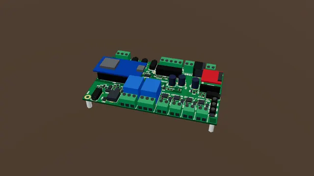

# Meet your board and connect to it

A quick tour of the board, then open its page on your phone. Every other guide tests with that page.

**Time:** 10 minutes · **Tools:** No tools

**Open the interactive version:** [html/00-meet-your-board.html](html/00-meet-your-board.html) (turn the 3D scene, step through, hear each step).

## You need

- [ ] The board (bare or in its case)
- [ ] A 12 V power supply (see "Powering the board safely")
- [ ] A phone or laptop with Wi-Fi and a web browser

## Before you start

- Unplug the power supply while you wire.
- Low voltage only: nothing here touches wall power.
- Strip about 7 mm, twist, tighten each screw on bare copper, tug each wire.

## Steps

1. **Front and back.** In these guides, the front is the edge with the long row of screw terminals. Turn the board so that edge faces you. Left and right are then your left and right.
2. **The front edge.** Along the front, from the left: TRIG1, a round jack for a button. RLY1 and RLY2, two relays (on every board built so far, rev A, the relays are for low-voltage DC only, 30 V at most: the silkscreen says "RELAYS: <=30V DC ONLY"). And OUT1 to OUT4, four outputs that switch power to lamps, valves and motors.
3. **The back edge.** Along the back, from the left: PIXEL for a colour pixel strip. TRIG2 for a motion sensor. CONTACT1 and CONTACT2, to start another controller. RAILS, which gives power to sensors. The power input. And SPK, for a speaker.
4. **Sound and the brain.** On the right is the sound module, with the slot for the memory card, and the LINE OUT jack for an amplifier. In the middle sits the controller module, the brain. Its light shows it has power.
5. **The white printing.** The white printing on the board is called the silkscreen. It names every terminal and every screw. When a guide says the screw marked plus, look for the plus in the silkscreen next to it.
6. **Power it.** Plug in the power supply. The guide called Powering the board safely shows how. The controller module’s light comes on. After about ten seconds the board is ready.
7. **Connect your phone.** On your phone, open the Wi-Fi settings. Join the network called Proptroller-XXXX (the last four letters or numbers differ from board to board). The password is password, all lower case (a simple default: you can change it later in Settings, Wi-Fi). Then open the web browser and type 192.168.4.1.
8. **What you should see.** The board’s page opens on the Live tab. At the top is the board’s name and a red STOP button. Below are cards: Status, Shows, Inputs and Outputs. The Inputs card shows a box for each input. A box lights up orange while that input is pressed.
9. **STOP and Auto.** The red STOP button stops every show and lets go of every output you switched by hand. On the Outputs card, On and Off take over an output for a test. Auto gives it back to your shows. Always press Auto after a test.
10. **Your home Wi-Fi (optional).** To use your home Wi-Fi too: on the Settings tab, fill in "Wi-Fi network" and "Wi-Fi password", press Save settings, then Restart. The board’s own Proptroller-XXXX network stays on, and the top of its Live tab there shows its address on your home Wi-Fi. On your home Wi-Fi, open the board’s name followed by .local (the Name setting, for example http://proptroller.local). In Specter Studio, boards on your network show up by themselves.

## Not working?

- No Proptroller network: wait 30 seconds after power-on. Is the controller module’s light on? The board makes this network even when it is on your home Wi-Fi.
- The phone joins but the page does not open: turn mobile data off for a moment, and type the whole address: http://192.168.4.1
- The phone says "no internet" and leaves the network: choose "stay connected" or "use this network anyway".
- Name.local does not open (some Android phones): use the board’s address from your router, or go back to the Proptroller network.

## Next

- [Powering the board safely](08-powering-the-board.md)
- [The starter kit: your first hour](starter-kit/README.md)
- [A push button on TRIG1](01-button-on-trig1.md)

## Words in this guide

- **silkscreen**: The white printing on the board that names each terminal and screw.
- **terminal**: A block with screws on the board edge. Push a bare wire end in under the screw and tighten it.
