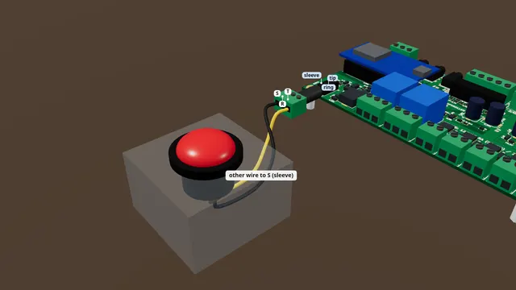

# A push button on TRIG1

Wire a big push button (or a step mat) to the TRIG1 input and see the board notice the press.

**Time:** 5 minutes · **Tools:** Small screwdriver

**Open the interactive version:** [html/01-button-on-trig1.html](html/01-button-on-trig1.html) (turn the 3D scene, step through, hear each step).

## You need

- [ ] A push button with two wires (an arcade button, a doorbell button) or a step mat
- [ ] A 3.5 mm stereo (TRS) plug with screw terminals, sold as a "3.5 mm male to 3 screw terminal adapter" (its screws are often marked L, R, G)
- [ ] Easiest of all: a button sold for props with a 3.5 mm stereo plug already on its cable. Then you skip the screws: plug it in and go to "Test it"
- [ ] A small flat screwdriver and wire strippers

## Before you start

- Unplug the power supply while you wire.
- Low voltage only: nothing here touches wall power.
- Strip about 7 mm, twist, tighten each screw on bare copper, tug each wire.
- **Don’t:** No battery or power supply on TRIG1.
- **Don’t:** Nothing on the R screw for a button.
- **Don’t:** Never wall power near the jacks.

## Steps

1. *Bare board:* **Find TRIG1.** Find TRIG1. It is the round jack at the front left corner of the board.
2. *In the case:* **Find TRIG1.** Your board is in the case, so use the jack marked TRIG1 on the front plate. The plug and the wiring are the same as on the bare board.
3. **Plug in.** Push the stereo plug all the way into TRIG1, until it stops.
4. **One wire to T.** Strip about 7 mm off each button wire and twist the strands. Put one wire under the screw marked T (tip), and tighten it. On many plugs that screw is marked L instead.
5. **Other wire to S.** Put the other wire under the screw marked S (sleeve), or G on many plugs. Leave the R screw empty. A button has no plus or minus, so either wire can go on either screw.
6. **Tug test.** Give each wire a gentle tug. If one pulls out, open the screw and do it again. Check that no stray strand touches the next screw.
7. **Test it.** Power the board and open its page on your phone. Stay on the Live tab. Press the button. In the Inputs card, the TRIG1 box lights up orange while you hold it, and goes dark when you let go.
   (How to open the board’s page: [Meet your board](00-meet-your-board.md), step "Connect your phone".)
8. **Use it in a show.** In a show script, `wait for trig1` waits for your button. For example: `effect hello:`, then `wait for trig1`, `out1 = on`, `wait 2`, `out1 = off`. Or, on the Shows tab, pick TRIG1 under "Starts on".

## Not working?

- Nothing lights on the page: push the plug in harder. It must go all the way in.
- Check the two wires are on T and S (L and G), not on R.
- Touch a short bare wire across the T and S screws: if TRIG1 lights, the button or its wires are the problem.
- TRIG1 is lit all the time: a stray strand joins T and S, or the button is the kind that is closed until pressed. If your switch has three tabs, use the ones marked C (or COM) and NO.

## Next

- [A motion sensor on TRIG2](03-motion-on-trig2.md)
- [A 12 V lamp or LED strip on OUT1](02-lamp-on-out1.md)
- [The starter kit: your first hour](starter-kit/README.md)

## Words in this guide

- **terminal**: A block with screws on the board edge. Push a bare wire end in under the screw and tighten it.
- **TRS**: A 3.5 mm plug with three parts: tip, ring and sleeve (headphone plugs are this kind). A mono plug has only two.
- **tip, ring, sleeve**: The three metal parts of a 3.5 mm stereo plug: tip at the end, ring in the middle, sleeve nearest the handle. Screw adapters often mark them L, R and G (or −).
