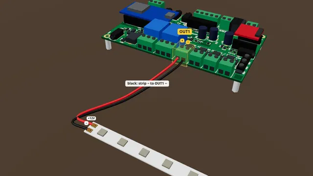

# A 12 V lamp or LED strip on OUT1

Wire a single-colour 12 V LED strip or lamp to OUT1 so the board can switch it on, off and dim it.

**Time:** 10 minutes · **Tools:** Small screwdriver

**Open the interactive version:** [html/02-lamp-on-out1.html](html/02-lamp-on-out1.html) (turn the 3D scene, step through, hear each step).

## You need

- [ ] A single-colour 12 V LED strip with two wires (+ and −), or a 12 V lamp: it must match your supply voltage
- [ ] Red and black wire, 18 AWG (about 1 mm²) for up to 5 A
- [ ] A small flat screwdriver and wire strippers
- [ ] In the case: a lead with a 5.5 x 2.1 mm barrel plug, and a multimeter to check which pin is +

## Before you start

- Unplug the power supply while you wire.
- Low voltage only: nothing here touches wall power.
- Strip about 7 mm, twist, tighten each screw on bare copper, tug each wire.
- **Don’t:** No lamp that plugs into the wall.
- **Don’t:** Never across another device’s button or remote.
- **Don’t:** No colour-changing (4-wire) strip on one OUT.

## Steps

1. **Check your strip.** The strip must run on the same voltage as your supply, usually 12 V. One output can carry up to 5 A: about 4 m of a typical 60 LED/m strip (check its label: a full 5 m reel draws about 6 A, so split it over two outputs). To dim it, keep it under 2 A at 12 V (about 1.5 m), or under 1 A on a 24 V supply.
2. *Bare board:* **Find OUT1.** Find OUT1 on the front edge. It has two screws. The silkscreen reads plus, OUT1, minus. Plus is on the left.
3. *In the case:* **Find OUT1.** In the case, OUT1 is the first round power jack on the front plate (5.5 x 2.1 mm). Which pin is + depends on how your case was wired. Unless the plate is marked, check it with a meter: on the page, Live > Outputs > OUT1 > On; red probe in the centre, black on the outside; 12 means the centre is +. Then press Auto. No meter? Open the lid and use the OUT1 screws instead.
4. **Red to plus.** Strip about seven millimetres off each wire and twist the strands. Put the strip’s plus wire, usually red, under the plus screw, and tighten it.
5. **Black to minus.** Put the minus wire, usually black, under the minus screw. Plus to plus, minus to minus.
6. **Tug test.** Give each wire a gentle tug. If one pulls out, open the screw and do it again. Check that no stray strand touches the next screw.
7. **Test it.** Power the board and open its page on your phone. On the Live tab, in the Outputs card, press On next to OUT1. The small green light by OUT1 comes on, and so does the strip. Then press Auto, so your shows can use it again.
   (How to open the board’s page: [Meet your board](00-meet-your-board.md), step "Connect your phone".)
8. **Use it in a show.** In a show script, `out1 = on` turns it on, `out1 = off` turns it off, `out1 = 50%` dims it to half, and `flicker out1 for 5` makes a failing-bulb flicker.

## Not working?

- The green light by OUT1 comes on but the strip stays dark: plus and minus are swapped, or a screw grips insulation instead of copper.
- Nothing lights at all: did you press On for OUT1 (not OUT2)? Does the board have power?
- The strip is dim at the far end or flickers: a long strip needs thicker wire, or a feed at both ends.
- The supply shuts off, especially with an old-style bulb (halogen): a cold bulb draws many times its rating for a moment. Keep each output under 5 A and the whole board under 10 A.

## Next

- [A 12 V air valve on OUT1](07-air-valve-on-out.md)
- [A pixel strip on PIXEL](05-pixel-strip.md)
- [Powering the board safely](08-powering-the-board.md)

## Words in this guide

- **silkscreen**: The white printing on the board that names each terminal and screw.
- **multimeter**: A tester that measures volts. Set it to DC V (a V with a straight line), red lead in V, black lead in COM.
