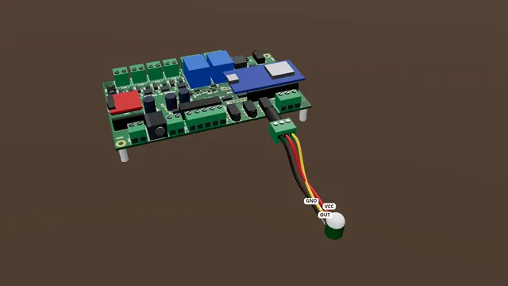

# A motion sensor on TRIG2

Wire a mini 3-pin motion sensor to TRIG2, powered by the jack itself, so a prop starts when someone walks by.

**Time:** 15 minutes · **Tools:** Small screwdriver

> **Firmware:** Needs firmware v0.1.0-rc.1 or later (it has the "TRIG2 input type" setting). If your Settings tab has no "TRIG2 input type", update the firmware first (Firmware tab).

**Open the interactive version:** [html/03-motion-on-trig2.html](html/03-motion-on-trig2.html) (turn the 3D scene, step through, hear each step).

## You need

- [ ] A mini 3-pin PIR motion sensor, the AM312 kind (2.7-12 V, pins VCC, OUT, GND). Its output must drive low when idle: AM312 sensors are expected to (not yet tried on a real board)
- [ ] A 3.5 mm stereo (TRS) plug with screw terminals (screws often marked L, R, G)
- [ ] Three wires (red, yellow, black). Easiest: a sensor sold with wires already fitted
- [ ] A small flat screwdriver and wire strippers

## Before you start

- Unplug the power supply while you wire.
- Low voltage only: nothing here touches wall power.
- Strip about 7 mm, twist, tighten each screw on bare copper, tug each wire.
- **Don’t:** Nothing safety-related on a powered sensor.
- **Don’t:** No other supply on the R screw.
- **Don’t:** No signal above 3.3 V on T.

> **Warning:** Unplugged = motion. In this mode a loose or unplugged cable reads as someone there. Never use it for anything safety-related: use a switch for that.

## Steps

1. *Bare board:* **Find TRIG2.** TRIG2 is the round jack on the back edge, next to the PIXEL terminal. Push a stereo plug with screw terminals all the way in.
2. *In the case:* **In the case: use TRIG1.** In the case, the lid button is wired to TRIG2, and pressing it would short a powered sensor. So in the case, plug the sensor into TRIG1 on the front plate instead. The wiring is the same.
3. **Three wires.** Now three wires. The sensor’s VCC goes to R (the ring, which gives 3.3 V). Its OUT goes to T (the tip; L on many plugs). Its GND goes to S (the sleeve; G or − on many plugs).
4. **Tug test.** Give each wire a gentle tug. If one pulls out, open the screw and do it again. Check that no stray strand touches the next screw.
5. *Bare board:* **Tell the board.** This sensor’s signal goes high when it sees someone, the opposite of a button. On the phone page: Settings > Inputs > TRIG2 input type > sensor_high > Save settings. (sensor_high means "powered sensor, its signal goes high".)
6. *In the case:* **Tell the board.** This sensor’s signal goes high when it sees someone. On the phone page: Settings > Inputs > TRIG1 input type > sensor_high > Save settings.
7. **Test it.** Power the board and wait a minute: motion sensors need about a minute to settle after power-on, and may fire on their own until then. Open the Live tab. Wave in front of the sensor. In the Inputs card, TRIG2 (TRIG1 in the case) lights up orange for a couple of seconds.
   (How to open the board’s page: [Meet your board](00-meet-your-board.md), step "Connect your phone".)
8. **Use it in a show.** In a show script, `wait for trig2` (or `wait for trig1` in the case) waits for someone to walk by. End the effect with a rest, for example `wait 20`, so it does not fire again straight away.
9. *Bare board:* **Long cable: a 12 V sensor (optional).** For a long cable, use a 12 V sensor with a relay output instead. NO goes to T and COM to S. Power it from RAILS: VIN through a 0.5 A fuse to +12V, GND to GND (RAILS gives the supply’s voltage, so match the sensor to it). Set TRIG2 input type back to "switch" and Save settings.
10. *Bare board:* **Bigger sensors (optional).** A sensor that needs 5 V, like the HC-SR501, can take its power from RAILS: 5V to its VCC, GND to its GND. Its signal goes to T and its GND also to S, and keep sensor_high. Its signal must not go above 3.3 V (the HC-SR501’s does not).

## Not working?

- Lit all the time, and goes dark when someone moves: the input type is still "switch". Set it to sensor_high and press Save settings.
- Lit all the time even on sensor_high: your sensor’s output cannot pull the input low against the board’s pull-up (it needs to sink about 0.7 mA). Use a relay-output sensor (the optional step).
- Never lights: check the three wires (VCC on R, OUT on T, GND on S), that the plug is all the way in, and that you waited a minute after power-on.
- It fires with nobody there: keep the sensor away from heaters, fans and sunlight; it also fires while it settles after power-on.

## Next

- [A push button on TRIG1](01-button-on-trig1.md)
- [A speaker and sound files](04-speaker-and-sounds.md)
- [The starter kit: your first hour](starter-kit/README.md)

## Words in this guide

- **terminal**: A block with screws on the board edge. Push a bare wire end in under the screw and tighten it.
- **TRS**: A 3.5 mm plug with three parts: tip, ring and sleeve (headphone plugs are this kind). A mono plug has only two.
- **tip, ring, sleeve**: The three metal parts of a 3.5 mm stereo plug: tip at the end, ring in the middle, sleeve nearest the handle. Screw adapters often mark them L, R and G (or −).
- **COM, NO, NC**: The three contacts of a switch or relay. COM (common) joins NO (normally open) only while it is pressed or on, and joins NC (normally closed) the rest of the time.
- **active low**: Inputs read a voltage. A button pulls the input low (to ground). A powered sensor drives it high when it sees someone.
