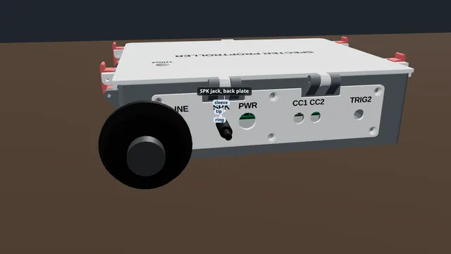

# A speaker and sound files

Wire a speaker to SPK and put your sounds on the memory card so a show can play them.

**Time:** 15 minutes · **Tools:** Small screwdriver

**Open the interactive version:** [html/04-speaker-and-sounds.html](html/04-speaker-and-sounds.html) (turn the 3D scene, step through, hear each step).

## You need

- [ ] A passive speaker (no power cord or battery), 4 Ω or more, rated 3 W or more
- [ ] A microSD card, 32 GB or smaller, formatted FAT32
- [ ] Two wires (any colour), a small flat screwdriver and wire strippers
- [ ] Your sounds as MP3 files

## Before you start

- Unplug the power supply while you wire.
- Low voltage only: nothing here touches wall power.
- Strip about 7 mm, twist, tighten each screw on bare copper, tug each wire.
- **Don’t:** No speaker wire to ground or any other screw.
- **Don’t:** Never SPK into an amplifier, headphones or an aux input.
- **Don’t:** No card bigger than 32 GB.

## Steps

1. *Bare board:* **Find SPK.** SPK is the two screw terminal at the back right corner.
2. *In the case:* **In the case.** In the case, the speaker plugs into the SPK jack on the back plate. Only plug in a speaker lead made for that jack. Never an amplifier, headphones or an aux cable. If the plate does not say how the jack is wired, open the lid and use the SPK screws instead.
   > **Warning:** The case’s SPK jack looks like a headphone jack but is not one. Speaker only.
3. **One wire to each screw.** Put one speaker wire under each SPK screw. Either way round works.
4. **Tug test.** Give each wire a gentle tug. If one pulls out, open the screw and do it again. Check that no stray strand touches the next screw.
5. **Amplifiers: LINE OUT.** Both SPK wires carry sound, so joining one to an amplifier’s ground can damage the sound module. For an amplifier or a powered speaker, use the LINE OUT jack on the right edge instead, with an ordinary audio cable.
6. **Sounds on the card: with Studio.** The easy way: in Specter Studio, open the SD card tool, add your sound files and put them in order. It erases the card, makes a folder for each sound and names the files: the first is sound 1, the second sound 2.
7. **Without Studio: one folder per sound.** Without Studio, each sound gets its own folder. Make a folder called 01 and put your first sound in it, named 001-name.mp3. Your second sound goes in folder 02, also named 001-name.mp3. That is sound 1 and sound 2 (docs/SD-CARD.md).
8. **Card in.** With the power off, slide the card into the slot on the sound module, at the right hand edge of the board, contacts first.
9. **Test it.** Power the board and open its page. On the Live tab, in the Sound card, set Sound to one and press Play. Your first sound plays. The Volume slider sets how loud.
   (How to open the board’s page: [Meet your board](00-meet-your-board.md), step "Connect your phone".)
10. **Use it in a show.** In a show script, `audio_single = 1` plays sound 1 once, `audio_loop = 2` loops sound 2, and `audio_volume = 60%` sets how loud the script plays them. The board's own sounds: Settings > Sound > "Trigger sound volume" and "Ambient volume", then Save settings.

## Not working?

- No sound: is the card in all the way, contacts first? Without Studio: are the folders named 01, 02 and the files 001-….mp3?
- Still nothing: Studio's SD card tool (Check a card) says what is wrong. Some computers add hidden files that begin with a dot; the tool removes those.
- Hum or buzz through an amplifier on LINE OUT: use a 3.5 mm ground-loop isolator on the LINE OUT lead.
- Quiet: raise the Volume slider on the Live tab, the volumes under Settings > Sound, or use LINE OUT with an amplifier.

## Next

- [The starter kit: your first hour](starter-kit/README.md)
- [A motion sensor on TRIG2](03-motion-on-trig2.md)
- [A pixel strip on PIXEL](05-pixel-strip.md)

## Words in this guide

- **terminal**: A block with screws on the board edge. Push a bare wire end in under the screw and tighten it.
