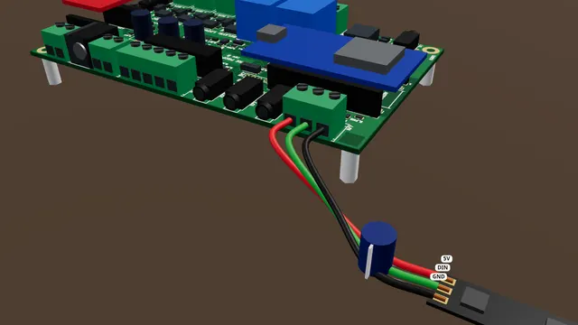

# A pixel strip on PIXEL

Wire a 5 V WS2812 (addressable RGB) pixel strip to PIXEL, and give a longer strip its own 5 V supply.

**Time:** 20 minutes · **Tools:** Screwdriver; soldering only on one path

**Open the interactive version:** [html/05-pixel-strip.html](html/05-pixel-strip.html) (turn the 3D scene, step through, hear each step).

## You need

- [ ] A 5 V WS2812 (addressable RGB) strip. Easiest: one with a 3-pin plug lead already fitted at its input end, plus a matching lead with bare wire ends
- [ ] A capacitor of 470-1000 µF, 6.3 V or more
- [ ] A small 3-way screw terminal block (or three lever connectors) to join the leads at the strip, with the capacitor’s legs
- [ ] Red, green and black wire, a small flat screwdriver and wire strippers
- [ ] Only for a strip with bare pads (no plug lead): a soldering iron and solder
- [ ] For more than about 15 lights: a listed 5 V supply big enough for the strip (about 60 mA per light at full white) and a barrel-to-screw adapter

## Before you start

- Unplug the power supply while you wire.
- Low voltage only: nothing here touches wall power.
- Strip about 7 mm, twist, tighten each screw on bare copper, tug each wire.
- **Don’t:** Never a 12 V strip on PIXEL.
- **Don’t:** Never join the board’s 5V to another supply.
- **Don’t:** Do not drop the GND wire.

## Steps

1. *In the case:* **In the case.** The case has no opening for PIXEL yet. For pixels, use the board out of its case for now, or run the lead out with the lid open.
2. **Find PIXEL.** PIXEL is the three screw terminal at the back left corner. The silkscreen reads GND, DATA, 5V.
3. **The capacitor.** At the strip’s input end (the end its arrows point away from), join the strip’s lead to your three wires in the screw block. Put the capacitor’s legs in with them: the long leg (+) with 5V, the striped side (−) with GND. Strip with bare pads and no lead? Solder the capacitor across its 5V and GND pads instead, stripe to GND, and solder the three wires to the pads (about 10 minutes with an iron).
4. **Three wires to PIXEL.** Now three wires to PIXEL: the strip’s five volts to 5V, its data to DATA, and its ground to GND.
5. **Tug test.** Give each wire a gentle tug. If one pulls out, open the screw and do it again. Check that no stray strand touches the next screw.
6. **Tell the board.** On the phone page: Settings > Pixels > "Pixels" = the number of lights on your strip, and "Pixel brightness" = 40 to start. Then Save settings.
7. **Test it.** Power the board and open the Live tab. In the Pixels card, pick a colour and the effect fill, and press Show. The strip lights up. Press Release when you are done.
   (How to open the board’s page: [Meet your board](00-meet-your-board.md), step "Connect your phone".)
8. **A longer strip.** The board gives the strip about one amp, enough for about fifteen lights at full white. For more, give the strip its own five volt supply. Take the board’s five volt wire off.
9. **Its own supply.** The supply’s plus goes to the strip’s five volts, and its minus to the strip’s ground. Keep the DATA and GND wires to the board: the grounds must be joined. Plug both supplies into one power strip, so they switch on and off together.
10. **Use it in a show.** In a show, record a pixel track on the Record tab, or use the starter kit’s pixel shows. A show then plays it when its input fires.

## Not working?

- Nothing lights: the data wire must go to the strip’s input end (DIN), not the output end. The arrows on the strip point away from the input.
- Only the first light works, or colours are wrong: check "Pixels" in Settings and the DATA wire.
- Lights flicker or go random: the GND wire between the board and the strip is missing or loose.
- The board resets when the strip lights up: too many lights on the board’s 5 V. Lower the brightness or give the strip its own supply.

## Next

- [The starter kit: your first hour](starter-kit/README.md)
- [A 12 V lamp or LED strip on OUT1](02-lamp-on-out1.md)
- [A speaker and sound files](04-speaker-and-sounds.md)

## Words in this guide

- **silkscreen**: The white printing on the board that names each terminal and screw.
- **terminal**: A block with screws on the board edge. Push a bare wire end in under the screw and tighten it.
- **capacitor**: A part that stores a little energy and smooths the supply. The big round kind has a − stripe down its side.
