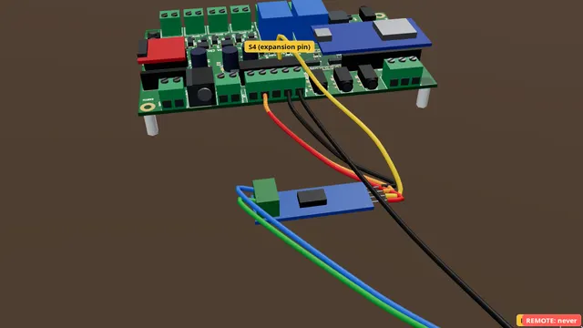

# Fog on cue: a fog machine with DMX IN

Let a show puff fog on cue through the fog machine’s DMX IN socket and a small DMX add-on. Never its wired remote.

**Time:** 30 minutes · **Tools:** Screwdriver; soldering only on one path

> **Firmware:** Needs firmware v0.1.0-rc.1 or later (it has the "DMX port" setting). The DMX add-on is not yet tried on a real board or fog machine: test it before a show.

**Open the interactive version:** [html/06-fog-over-dmx.html](html/06-fog-over-dmx.html) (turn the 3D scene, step through, hear each step).

## You need

- [ ] A fog machine with a socket labelled DMX IN (3-pin XLR). A machine with only a REMOTE socket or a wired remote is not covered
- [ ] A "MAX485 TTL to RS-485" module (5 V, often sold in packs)
- [ ] A 3-pin XLR female to bare-wire pigtail (or a DMX cable cut in half)
- [ ] Four jumper wires with a socket (female) end for the expansion pins, and short wires for RAILS
- [ ] The expansion pins (S / V / G rows) and the RAILS terminal fitted on your board. Both are optional in the build: if yours has no pins there, they need soldering first
- [ ] A button on TRIG1 to test with (guide 1)
- [ ] A small flat screwdriver and wire strippers

## Before you start

- Unplug the power supply while you wire.
- Low voltage only: nothing here touches wall power.
- Strip about 7 mm, twist, tighten each screw on bare copper, tug each wire.
- **Don’t:** Never the machine’s wired remote or its REMOTE socket.
- **Don’t:** Never open the fog machine.
- **Don’t:** Nothing safety-related on this add-on.

> **Warning:** DMX IN, never REMOTE. Many fog machines’ wired remotes and remote sockets carry wall power (mains). These guides never connect to them.

## Steps

1. **Check the machine.** Look at the back of the fog machine. You need a socket labelled DMX IN. It looks like a microphone socket with three pins. If your machine has only a remote socket, it is not covered by these guides.
2. *In the case:* **In the case.** The case has no opening for the expansion pins yet. For now, use the board out of its case, or work with the lid open.
3. **Find RAILS and S4.** Find RAILS on the back edge: five screws, VIN, 5V, 3V3, GND, GND. Then find the expansion pins: three rows of eleven pins, marked S, V and G. The fourth pin of the S row is S4. No pins there? They need soldering first (ask whoever built the board).
4. **Power the module.** Wire the module’s VCC to the RAILS screw marked 5V, and its GND to a RAILS GND screw. Join the module’s DE and RE pins, and wire them to 5V too. Then it always sends.
5. **Data to S4.** Wire the module’s DI pin to S4, the fourth pin of the expansion S row.
6. **The XLR plug.** Now the XLR pigtail. The module’s A goes to XLR pin 3 (Data +), its B to pin 2 (Data −), and a wire from a RAILS GND screw to pin 1. The pin numbers are printed tiny on the plug.
7. **Tug test.** Give each wire a gentle tug. If one pulls out, open the screw and do it again. Check that no stray strand touches the next screw.
8. **Tell the board.** On the phone page: Settings > Expansion > DMX port > s4 > Save settings.
9. **Set up the machine.** Set the fog machine to DMX mode, address one. Its manual shows how: often small switches or a menu. If it has a DMX OUT socket too, leave it empty, or fit a DMX terminator if the manual asks for one. Then plug the XLR into DMX IN.
10. **Warm it up.** A fog machine only fogs when its heater is ready. A cold machine does nothing, and the board cannot tell. Switch the machine on a few minutes before the show.
11. **Test it.** On the Script tab, paste a test effect: `effect fog:`, `wait for trig1`, `dmx1 = 100%`, `wait 4`, `dmx1 = off`, `wait 45`. Press Check, then Save. Press your TRIG1 button: the machine puffs fog for 4 seconds.
   (How to open the board’s page: [Meet your board](00-meet-your-board.md), step "Connect your phone".)
12. **Use it in a show.** In a show script, `dmx1 = 100%` starts fog, `dmx1 = off` stops it, and `dmx1 = 50%` asks for less if your machine supports it. End the effect with a long rest (`wait 45`): a fog machine needs time to heat up again.

## Not working?

- The Check button says the DMX add-on is not turned on: set Settings > Expansion > DMX port to s4 and Save settings.
- No fog: is the machine warm (its ready light on)? Is it in DMX mode at address 1? Is the XLR in DMX IN?
- Still no fog: swap the A and B wires at the XLR (pins 2 and 3). The A/B order has not been tested on a real machine yet.
- The board does not start, or restarts, with the module fitted (ESP32 boards): power off, take the DI wire off S4, power up, then power off again and refit it. Report it: S4 is a pin the ESP32 reads at start-up.

## Next

- [A push button on TRIG1](01-button-on-trig1.md)
- [A motion sensor on TRIG2](03-motion-on-trig2.md)
- [The starter kit: your first hour](starter-kit/README.md)

## Words in this guide

- **DMX**: A standard way for show controllers to talk to lights and fog machines over a 3-pin (or 5-pin) XLR cable.
