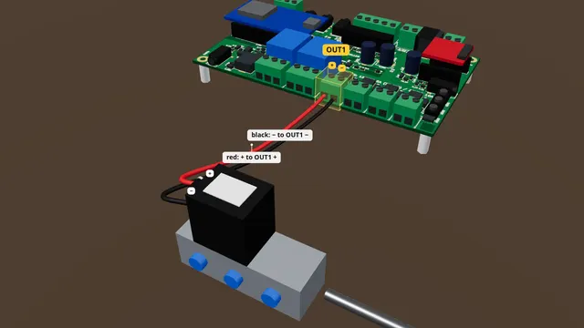

# A 12 V air valve on OUT1

Wire a DC 12 V air valve (or a push solenoid) to OUT1 for a jump scare, with a diode across its coil.

**Time:** 15 minutes · **Tools:** Screwdriver; soldering only on one path

**Open the interactive version:** [html/07-air-valve-on-out.html](html/07-air-valve-on-out.html) (turn the 3D scene, step through, hear each step).

## You need

- [ ] An air valve (solenoid valve) whose coil says DC 12V (or DC 24V on a 24 V supply), drawing under 5 A. Never a coil marked AC
- [ ] A diode across the coil. Easiest: a valve or coil plug sold with the diode already fitted ("with suppression diode" or "with LED and diode")
- [ ] If yours has no diode: a 1N4007 (or 1N5819, SS54), a soldering iron and solder, and heat-shrink tube
- [ ] Red and black wire, 18 AWG, a small flat screwdriver and wire strippers
- [ ] A multimeter (to check the case’s OUT jack, or unmarked leads)

## Before you start

- Unplug the power supply while you wire.
- Low voltage only: nothing here touches wall power.
- Strip about 7 mm, twist, tighten each screw on bare copper, tug each wire.
- **Don’t:** Never a coil marked AC.
- **Don’t:** No diode backwards: it shorts the output.
- **Don’t:** Never across another device’s button.

## Steps

1. **Check the coil.** Read the coil’s label. It must say DC 12V (or DC 24V on a 24 V supply) and draw less than 5 A. Coils marked AC110V or AC220V are for wall power: never use them here.
2. **The diode.** A coil kicks back a spike when it switches off. The board has a diode on each output already; a second one right at the coil protects long wires. Fitted already? Check its stripe is on the + side (the wire that goes to OUT1 +). Not fitted? Solder a 1N4007 across the coil’s two terminals, stripe on +, and cover the joints with heat-shrink (about 10 minutes).
3. *Bare board:* **Find OUT1.** Find OUT1 on the front edge. The silkscreen reads plus, OUT1, minus. Plus is on the left.
4. *In the case:* **Find OUT1.** In the case, OUT1 is the first round power jack on the front plate. With a diode fitted, a lead the wrong way round shorts the output. Unless the plate is marked, check it first: Live > Outputs > OUT1 > On, red probe in the centre, black outside; 12 means the centre is +; then Auto. Or open the lid and use the OUT1 screws.
5. **Wire it.** The valve’s plus wire, the one on the diode’s stripe side, goes to the plus screw of OUT1. The minus wire goes to the minus screw.
6. **Tug test.** Give each wire a gentle tug. If one pulls out, open the screw and do it again. Check that no stray strand touches the next screw.
7. **Test it.** Power the board. On the Live tab, in the Outputs card, press On next to OUT1. The valve clicks, and the light by OUT1 comes on. Then press Auto.
   (How to open the board’s page: [Meet your board](00-meet-your-board.md), step "Connect your phone".)
8. **A safety limit.** Air valves may stay on. A push solenoid is made for short pulses and gets hot. For a solenoid: Settings > Watchdogs > "OUT1 max on" = 2000 (ms) > Save settings. The board then switches it off after 2 s, whatever the show says.
9. **Use it in a show.** In a show script: `out1 = on`, `sleep 0.5`, `out1 = off` gives a half-second blast.

## Not working?

- Nothing moves but the OUT1 light comes on: check the wires, and that the valve has air pressure.
- The supply shuts off the moment OUT1 switches on: the diode is backwards (or the case lead is reversed). Power off and turn it round.
- It buzzes or moves weakly: the supply is too small, or the wires are too thin.
- The board restarts when it fires: use a bigger supply, and check the diode is fitted.

## Next

- [A 12 V pump or motor on OUT1](10-pump-or-motor-on-out.md)
- [A 12 V lamp or LED strip on OUT1](02-lamp-on-out1.md)
- [Powering the board safely](08-powering-the-board.md)

## Words in this guide

- **silkscreen**: The white printing on the board that names each terminal and screw.
- **flyback diode**: A small part that lets current flow one way only. Across a coil it soaks up the spike when the coil switches off. Its stripe end is the cathode and goes to +.
