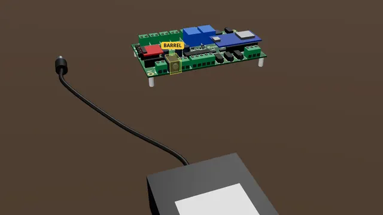

# Powering the board safely

Pick the supply, check its plus and minus with a meter, then plug it into the barrel jack (up to 5 A) or wire the screw terminal (up to 10 A).

**Time:** 10 minutes · **Tools:** No tools

**Open the interactive version:** [html/08-powering-the-board.html](html/08-powering-the-board.html) (turn the 3D scene, step through, hear each step).

## You need

- [ ] A listed 12 V DC supply (UL, ETL or CSA mark on it) with over-current protection: a plug-in one with a 5.5 x 2.1 mm centre-positive plug (up to 5 A), or an enclosed one installed by a qualified person (up to 10 A)
- [ ] A multimeter (any cheap one) to check plus and minus
- [ ] For the screw terminal: red and black wire, 16 AWG (about 1.5 mm²), and a small flat screwdriver

## Before you start

- Unplug the power supply while you wire.
- Low voltage only: nothing here touches wall power.
- Strip about 7 mm, twist, tighten each screw on bare copper, tug each wire.
- **Don’t:** Never two supplies at once.
- **Don’t:** Never above 24 V (do not turn an adjustable supply up).
- **Don’t:** No guitar-pedal adapter: most are centre-negative.

## Steps

1. **Match your loads.** Your lamps, strips and valves run on the supply voltage. So if they are twelve volt parts, use a twelve volt supply.
2. **How many amps.** Add up the amps of everything on the outputs, and add one and a half amps for the board itself. Pick a supply bigger than that, and never more than ten amps. Through the barrel jack, five amps at most.
3. **No fuse on the board.** The board has no fuse. A listed supply switches itself off on a short, but often only well above its rating. So staying inside the amps is your job.
4. **Check plus and minus.** Before the first plug-in, check the supply with a meter. Set the meter to DC V (a V with a straight line). Plug the supply into the wall, its plug not in the board. Red probe inside the plug (the centre), black probe on the outside. 12 means centre positive, right. −12 means swapped: do not use it. Most supplies also show the symbol (−)–C–(+) for centre positive.
5. *Bare board:* **Up to 5 A: the barrel jack.** For up to 5 A, push the 5.5 x 2.1 mm plug into the round jack on the back edge.
6. *Bare board:* **Up to 10 A: the terminal.** For more, use the screw terminal marked minus, nine to twenty four volts in, plus. Use thick wire, and check plus and minus with the meter before you connect. The enclosed supply’s wall side must be covered and installed by someone qualified: ask the person who does your show’s electrics.
7. *In the case:* **In the case: PWR only.** In the case, the supply plugs into the jack marked PWR on the back plate, and nowhere else. The OUT jacks on the front take the same plug, but a supply there feeds the board backwards through an output that then cannot switch off. Through the PWR jack, five amps at most.
   > **Warning:** Supply into PWR only, never into an OUT jack.
8. **One supply only.** The barrel jack and the terminal are joined inside. Use one of them, never both at once.
9. **First power-on.** Switch on with nothing connected to the outputs. The controller module’s light comes on, and the board’s Wi-Fi network appears on your phone. Then power off and add your loads.
   (How to open the board’s page: [Meet your board](00-meet-your-board.md), step "Connect your phone".)

## Not working?

- Nothing lights: is the supply switched on and its plug all the way in? Measure it with the meter.
- The supply clicks off or blinks: it is overloaded. Add up the loads again, or use a bigger supply (up to 10 A on the terminal).
- Outputs get hot below 12 V: below 12 V the outputs run hotter. Use 12 V or more.
- The barrel plug is loose: the board takes 5.5 x 2.1 mm plugs. A 5.5 x 2.5 mm plug fits but wobbles.

## Next

- [Meet your board and connect to it](00-meet-your-board.md)
- [The starter kit: your first hour](starter-kit/README.md)
- [A 12 V lamp or LED strip on OUT1](02-lamp-on-out1.md)

## Words in this guide

- **terminal**: A block with screws on the board edge. Push a bare wire end in under the screw and tighten it.
- **polarity**: Which wire is plus (+) and which is minus (−). Some parts work only one way round, and some are damaged backwards.
- **centre positive**: On a round barrel plug, the inside (centre) is + and the outside is −. The supply shows it with a little symbol: (−)–C–(+).
- **listed supply**: A power supply tested by a safety lab: it carries a UL, ETL or CSA mark on the product itself.
- **multimeter**: A tester that measures volts. Set it to DC V (a V with a straight line), red lead in V, black lead in COM.
