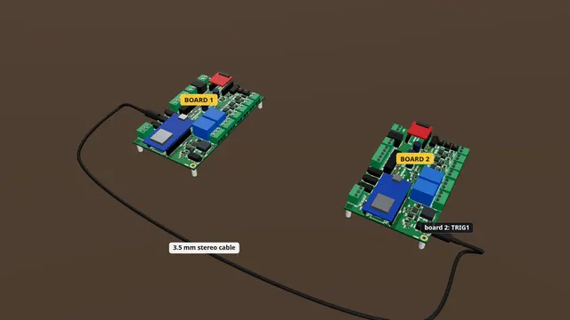

# Chaining two boards

One board starts the next: a plain 3.5 mm stereo cable from CONTACT1 to TRIG1.

**Time:** 5 minutes · **Tools:** No tools

**Open the interactive version:** [html/09-chaining-two-boards.html](html/09-chaining-two-boards.html) (turn the 3D scene, step through, hear each step).

## You need

- [ ] A second Proptroller (or another controller with a trigger input)
- [ ] A 3.5 mm stereo (TRS) male-to-male cable, as long as you need (not a mono cable)

## Before you start

- Unplug the power supply while you wire.
- Low voltage only: nothing here touches wall power.
- Strip about 7 mm, twist, tighten each screw on bare copper, tug each wire.
- **Don’t:** No lamp or motor on CONTACT.
- **Don’t:** Never more than 30 V DC.
- **Don’t:** Not a mono cable.

## Steps

1. *Bare board:* **What CONTACT1 is.** CONTACT1 is the round jack on the back edge, next to TRIG2. It is an isolated switch: tip is +, sleeve is −. On the phone page it is called CC1.
2. *In the case:* **In the case.** In the case, CONTACT1 is the jack marked CC1 on the back plate (looking at the back, CC2 sits to its left). Board two’s TRIG1 is the jack on its front plate.
3. **Plug in both ends.** With both boards unplugged, push one end of the stereo cable into CONTACT1 on board one, and the other end into TRIG1 on board two. A straight stereo cable joins tip to tip and sleeve to sleeve, which is just right.
4. **Board two: a switch input.** On board two’s page: Settings > Inputs > TRIG1 input type must be "switch" (sensor_high would fire the wrong way round). Save settings if you changed it.
5. **Board one: CC1 for shows.** On board one’s page: Settings > Output roles > "CC1 role" = shows > Save settings. Now board one’s shows and script can switch it.
6. **Test it.** Power both boards. On board one’s Live tab, in the Outputs card, press On next to CC1: on board two’s Live tab, the TRIG1 box lights up. Then press Auto on board one.
   (How to open the board’s page: [Meet your board](00-meet-your-board.md), step "Connect your phone".)
7. **Use it in a show.** In board one’s script, `cc1 = on`, `wait 0.5`, `cc1 = off` presses board two’s TRIG1. Board two waits with `wait for trig1` as usual.

## Not working?

- Board two’s TRIG1 never lights: is the cable stereo and pushed in at both ends? Is board one’s CC1 role set to shows (out of the box it is trigger_repeat, which pulses only when a show, not a script, starts)?
- TRIG1 on board two is lit all the time: its TRIG1 input type is sensor_high. Set it to switch.
- Swapped plugs: CONTACT1 has polarity. A straight stereo cable keeps tip to tip; a cable that swaps them will not work.
- Another brand of controller: its trigger input must want a contact closure; tip of CONTACT1 is +, so match its + and −.

## Next

- [A push button on TRIG1](01-button-on-trig1.md)
- [A motion sensor on TRIG2](03-motion-on-trig2.md)
- [Meet your board and connect to it](00-meet-your-board.md)

## Words in this guide

- **TRS**: A 3.5 mm plug with three parts: tip, ring and sleeve (headphone plugs are this kind). A mono plug has only two.
- **tip, ring, sleeve**: The three metal parts of a 3.5 mm stereo plug: tip at the end, ring in the middle, sleeve nearest the handle. Screw adapters often mark them L, R and G (or −).
- **dry contact**: A switch with no voltage of its own, like a finger pressing a button.
