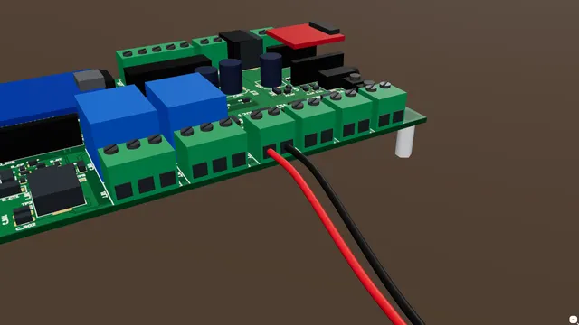

# A 12 V pump or motor on OUT1

Wire a 12 V DC pump, motor or store-bought 12 V pop-up to OUT1, with a soft start for the start-up surge.

**Time:** 10 minutes · **Tools:** Small screwdriver

**Open the interactive version:** [html/10-pump-or-motor-on-out.html](html/10-pump-or-motor-on-out.html) (turn the 3D scene, step through, hear each step).

## You need

- [ ] A 12 V DC pump or motor (or a pop-up prop that runs from a 12 V adapter) drawing under 5 A while running
- [ ] Red and black wire, 18 AWG (16 AWG for long runs), a small flat screwdriver and wire strippers
- [ ] For a brushed motor on a long lead (over about 1 m): a 1N4007 or 1N5819 diode across it, stripe on + (needs soldering)

## Before you start

- Unplug the power supply while you wire.
- Low voltage only: nothing here touches wall power.
- Strip about 7 mm, twist, tighten each screw on bare copper, tug each wire.
- **Don’t:** No motor that plugs into the wall.
- **Don’t:** No motor over 5 A running.
- **Don’t:** Never across another device’s button.

## Steps

1. **Check the label.** Read the label: twelve volts D C, and the running current under five amps. A motor draws much more for a moment as it starts. The board allows up to ten amps for under a second, and the soft start below helps.
2. *In the case:* **In the case.** In the case, OUT1 is the first round power jack on the front plate. Which pin is plus depends on how your case was wired: check with a meter, or open the lid and use the OUT1 screws.
3. **Wire it.** Unplug the power. The motor’s plus wire, usually red or marked with a dot, goes to the plus screw of OUT1. The minus wire goes to the minus screw.
4. **Tug test.** Give each wire a gentle tug. If one pulls out, open the screw and do it again. Check that no stray strand touches the next screw.
5. **Test it.** Power the board. On the Live tab, in the Outputs card, press On next to OUT1. The motor runs. If it turns the wrong way, power off and swap its two wires. Then press Auto.
   (How to open the board’s page: [Meet your board](00-meet-your-board.md), step "Connect your phone".)
6. **Soft start.** To ease the start-up surge: Settings > Outputs > "OUT1 soft start" = 500 (ms) > Save settings. The motor now speeds up over half a second.
7. **Use it in a show.** In a show script: `out1 = on`, `sleep 3`, `out1 = off`. `out1 = 60%` runs it slower (keep a dimmed motor under 2 A at 12 V). A pop-up that must stop at an end needs its own end switches: follow its maker’s wiring.

## Not working?

- It turns the wrong way: power off and swap the two wires. One OUT turns a motor one way only.
- The supply shuts off as the motor starts: the start-up surge is too big. Set a soft start, or use a bigger supply.
- It hums but does not turn: it is stuck, or the supply or wires are too small.
- The board restarts when it starts: use a bigger supply, set a soft start, and fit a diode across a brushed motor on a long lead.

## Next

- [A 12 V air valve on OUT1](07-air-valve-on-out.md)
- [A 12 V lamp or LED strip on OUT1](02-lamp-on-out1.md)
- [Powering the board safely](08-powering-the-board.md)

## Words in this guide

- **multimeter**: A tester that measures volts. Set it to DC V (a V with a straight line), red lead in V, black lead in COM.
