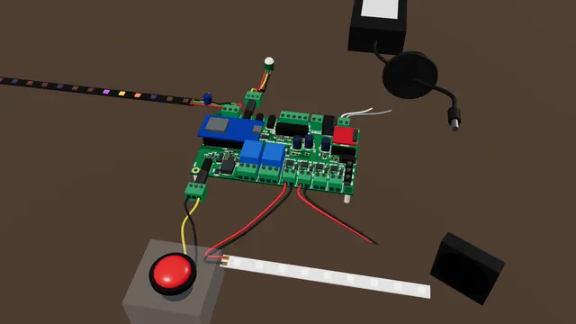

# The starter kit: your first hour

One big button, one motion sensor, a lamp strip, a fan, a pixel strip and a speaker, all on your desk and all wired
to one Proptroller. Press the button and the sound plays, the lamp flashes, the fan puffs and the pixels chase. Walk
past and it answers with a spooky sound and red flicker. When it sits idle, the pixels breathe a calm orange glow: it
is ready.

[](../html/kit-starter-kit.html)

**Open the interactive version:** [../html/kit-starter-kit.html](../html/kit-starter-kit.html). It is a 3D scene you
can turn, with every step read out.

**Time:** about an hour · **Tools:** small screwdriver, wire strippers, a multimeter · **First time?** Read
[Meet your board](../00-meet-your-board.md) (how to open the board's page on your phone) and
[Powering the board safely](../08-powering-the-board.md) first. The motion sensor needs a firmware with the
"TRIG2 input type" setting: firmware v0.1.0-rc.1 or later.

> **Low voltage only.** Everything in this kit runs on 12 V or 5 V. There is no wall-power (mains) wiring anywhere.
> Keep the power supply unplugged until the last step.

The board sits bare on the desk, on its standoffs, for this kit. The case has no opening for the PIXEL or RAILS
terminals, so a desk demo is easier without it.

## Shopping list

| What | How many | Notes |
|---|---|---|
| Proptroller board, built, with its controller module and sound module (DFPlayer Mini) | 1 | see `../../build-guide/` |
| 12 V DC power supply with a 5.5 x 2.1 mm centre-positive barrel plug | 1 | 3 A is plenty for this kit. It must be a listed supply with over-current protection: the board has no fuse |
| Multimeter (any cheap one) | 1 | to check the supply's plus and minus before the first plug-in ([guide 8](../08-powering-the-board.md)) |
| Big push button with two wires | 1 | either wire on either screw |
| Mini 3-pin PIR motion sensor (AM312 kind, 2.7-12 V, pins VCC, OUT, GND) | 1 | powered by the TRIG2 jack's 3.3 V ring. Its output must drive low at idle: AM312-type sensors are expected to, not yet tried on a real board; if not, use a 12 V relay-output PIR with a 0.5 A fuse as in [guide 3](../03-motion-on-trig2.md) |
| 3.5 mm stereo (TRS) plug with screw terminals | 2 | one for the button, one for the sensor. The screws are often marked L, R, G: T = L, R = R, S = G (or −) |
| Single-colour 12 V LED strip, about 30-50 cm, with leads | 1 | or any 12 V lamp up to a few amps |
| Small 12 V DC fan (40 or 60 mm) | 1 | or a 12 V buzzer |
| WS2812B pixel strip, 5 V, 15 LEDs | 1 | best: one with a 3-pin plug lead already fitted at its **input** (DIN) end, plus a matching lead with bare ends. A strip with bare pads needs soldering |
| Capacitor 1000 uF, 10 V or more | 1 | across 5V and GND at the strip's input, stripe (minus) on GND |
| Small 3-way screw terminal block (or three lever connectors) | 1 | joins the strip's lead to your wires, with the capacitor's legs: no soldering |
| Passive speaker, 4-8 ohm, rated 3 W or more | 1 | a small loose speaker is fine |
| microSD card, 32 GB or smaller, FAT32 | 1 | |
| Hook-up wire: red, black and a few other colours, 18-22 AWG | a few metres | |
| Small flat screwdriver, wire strippers | | |

## Wiring

| Thing | Goes to | Wire |
|---|---|---|
| Button, one wire / other wire | plug in **TRIG1**: screw T (L) / screw S (G) | yellow / black |
| Motion sensor VCC / OUT / GND | plug in **TRIG2**: screw R (3.3 V) / screw T (L) / screw S (G) | red / yellow / black |
| LED strip + / - | **OUT1** + / - (plus is on the left) | red / black |
| Fan red / black | **OUT2** + / - | red / black |
| Pixel strip 5V / DIN / GND | **PIXEL** 5V / DATA / GND (the board already has the data resistor); the capacitor across 5V and GND at the strip | red / green / black |
| Speaker, both wires | the two **SPK** screws, either way round. Never to ground, never to an amplifier | white / grey |
| Power supply | the round barrel jack on the back edge (5 A max through it) | |

The silkscreen names every terminal: `+ OUT1 -`, `PIXEL: GND DATA 5V`, `RAILS: GND GND 3V3 5V VIN`, `SPK`. The two
plugs have their screws marked T, R and S; only the motion sensor uses R (its 3.3 V supply).

**If you later put the kit in the case:** the case's lid button is wired to TRIG2, and pressing it would short the
mini sensor's output. Swap the two plugs (sensor on TRIG1, button on TRIG2), swap `trig1` and `trig2` in the script and
the two pixel shows' inputs, and set Settings > Inputs > TRIG1 input type (not TRIG2) to `sensor_high`.

## Sounds

Put the big sound on the microSD card as sound 1 and the spooky sound as sound 2. Specter Studio's SD card tool
does it for you: add the two files in that order and press Copy. By hand ([Setting up the SD card](../../SD-CARD.md)):

```
01/001-big.mp3      the big sound (sound 1)
02/001-spooky.mp3   the spooky sound (sound 2)
```

Slide the card into the sound module's slot at the right edge of the board, contacts first.

## The show

- [`starter-kit.txt`](starter-kit.txt): the show script (the board's beginner language). Two effects: **big
  moment** (TRIG1: sound 1, the fan puffs, the lamp flashes three times then fades) and **spooky** (TRIG2: sound 2, then
  a 20 s rest so walking past again does nothing).
- Three pixel shows, because the script language has no pixel line and nothing that starts at power-on:
  [`show-1-ready-glow.json`](show-1-ready-glow.json) (starts at power-on, loops: the calm glow),
  [`show-2-big-moment-pixels.json`](show-2-big-moment-pixels.json) (TRIG1: white flashes, an orange chase, a rainbow) and
  [`show-3-spooky-pixels.json`](show-3-spooky-pixels.json) (TRIG2: red flicker). The press shows have a higher priority,
  so the glow comes back by itself when they end.
- [`starter-kit-backup.json`](starter-kit-backup.json): all of the above plus the two pixel settings in one board
  backup file, for a tool that restores backups (it also sets `trig2_input = sensor_high`; firmware without that
  setting skips it). The phone page has no restore button yet, so load the pieces by hand:

**Load it from the phone page:**
1. **Script** tab: paste the whole of `starter-kit.txt`, press **Check**, then **Save**.
2. **Shows** tab: press **+ New**, open the **JSON** section, paste `show-1-ready-glow.json`, press **Apply JSON**, then
   **Save**. Do the same for show 2 and show 3.
3. **Settings** tab: **Pixels** > **Pixels** = 15 and **Pixel brightness** = 40; **Inputs** > **TRIG2 input type** =
   `sensor_high`; press **Save settings**, then **Restart**. (TRIG2 input type needs firmware v0.1.0-rc.1 or later; if your
   Settings tab has no such field, update the firmware first.)

Loading by hand is easier from a computer than from a phone.

**Checked:** the script passes the firmware's own checker (the C++ simulator's `check_script`, 2026-10-21):
`ok: true`, 2 effects, no errors, one warning, `effects "big moment" and "spooky" both play sound`. That warning is
expected: there is one sound player, so the newer sound replaces the one playing. On the simulator, with the backup
restored, one TRIG1 press played sound 1, switched OUT1 and OUT2 on, flashed OUT1 three times, switched OUT2 off after
about 2 s, faded OUT1 out and ran the pixel flash, chase and rainbow, after which the glow came back. A TRIG2 press
played sound 2 and the red flicker. Not yet tried on a real board.

## Press it

1. Check the supply with the meter (red inside the plug, black outside: +12), then plug it in. After a few seconds the pixels start their slow orange glow. Give the motion sensor a minute to settle.
2. Press the big button: sound, flashing lamp, fan puff, pixel chase. Press it again when it has finished.
3. Walk in front of the motion sensor: a spooky sound and red flicker. It waits 20 s before it reacts again.

## If it doesn't work

- Nothing happens at all: is the supply plugged in, and does the controller module's own power LED light? Does the
  phone page open?
- The page says the script has an error: paste the whole file again, from the first line to the last.
- The button does nothing: see [guide 1](../01-button-on-trig1.md) (plug fully in, wires on T and S).
- The motion sensor shows motion all the time: wait a minute after power-on, and check Settings > Inputs > TRIG2 input type is `sensor_high`; if it still does, its output cannot pull low:
  use a relay-output sensor ([guide 3](../03-motion-on-trig2.md)). In this mode an unplugged sensor counts as motion: fine
  for a spooky reaction, never for anything safety-related.
- The OUT1 or OUT2 light on the board comes on but the strip or fan does not: plus and minus swapped, or a screw on
  insulation.
- No sound: the card filled by Studio's SD card tool (or `01/001-….mp3` and `02/001-….mp3`), FAT32 and pushed in ([guide 4](../04-speaker-and-sounds.md)).
- The pixels stay dark: the DATA wire, the three shows on the Shows tab, Pixels = 15 in Settings.

## Next

[Make it bigger](make-it-bigger.md): more lights, fog on cue (DMX), an air valve, a longer pixel strip, a second board.
