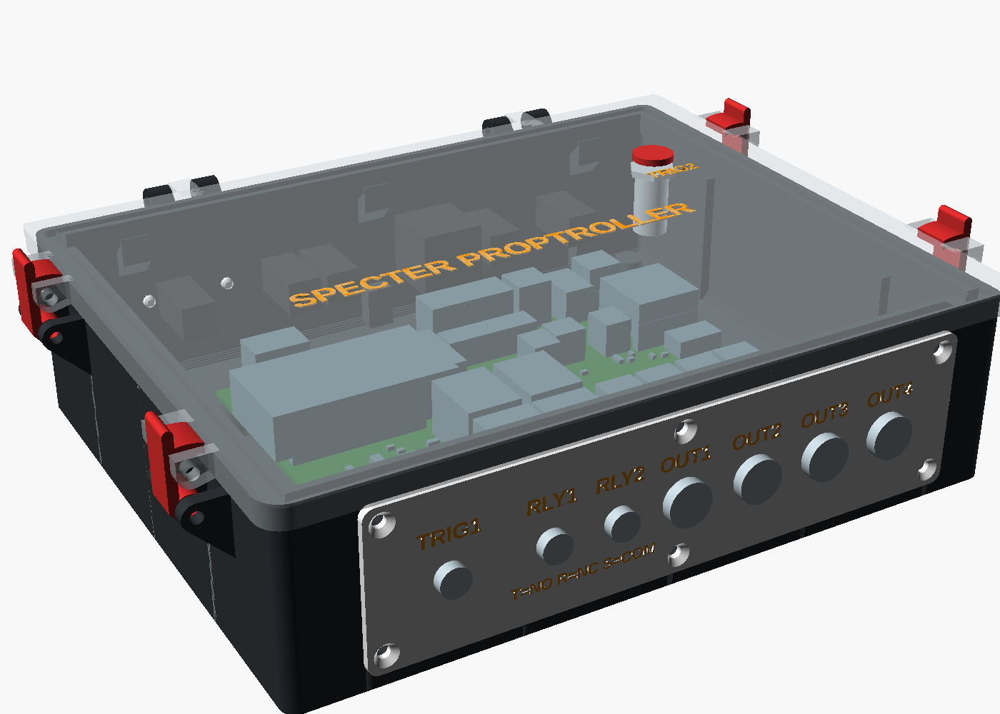
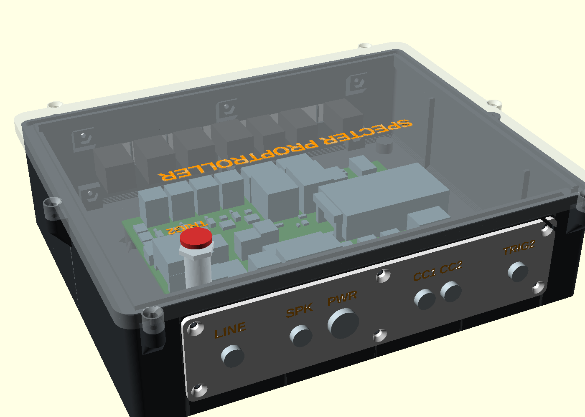
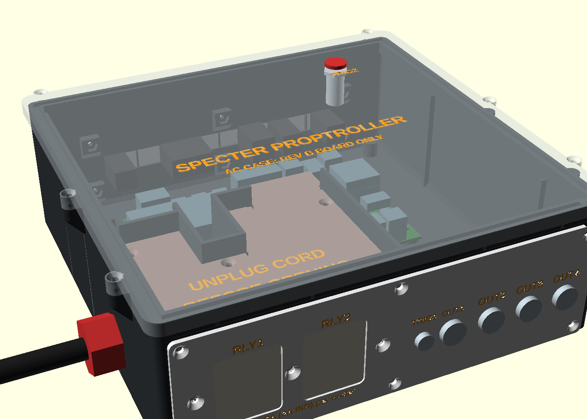
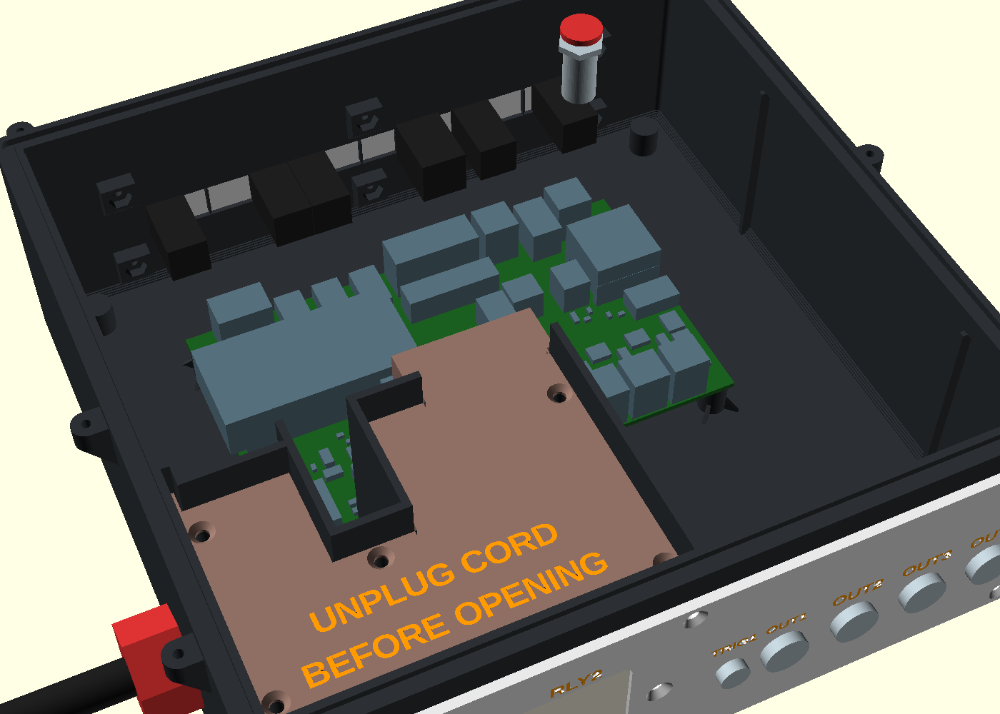
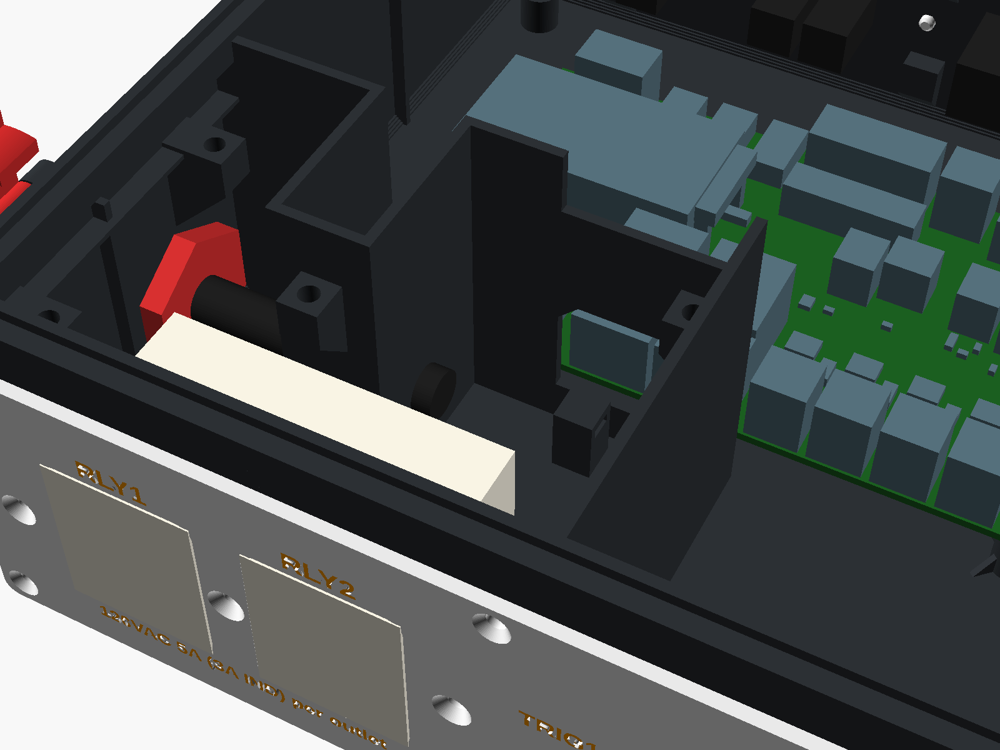
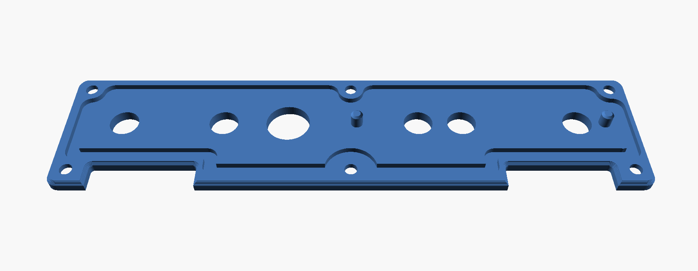
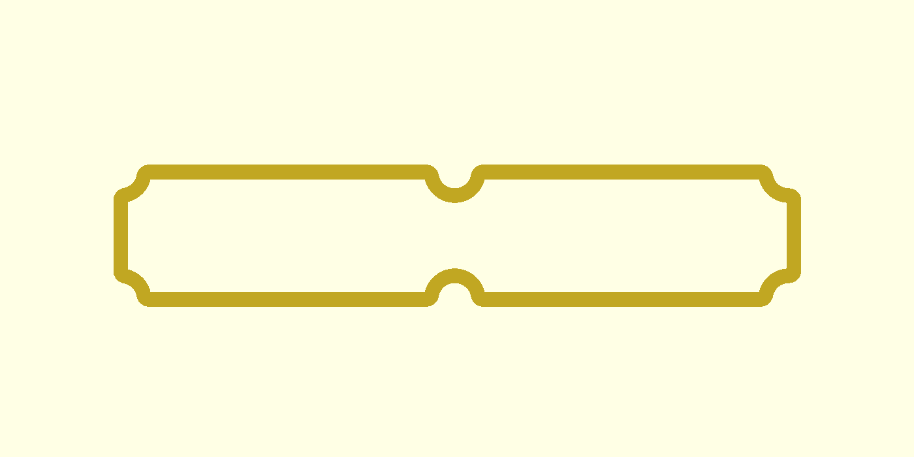
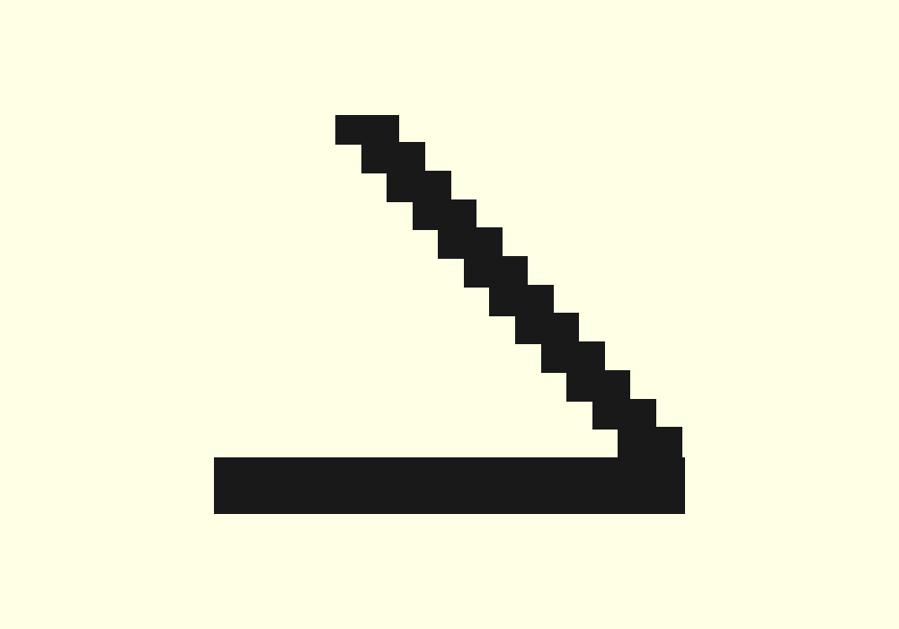
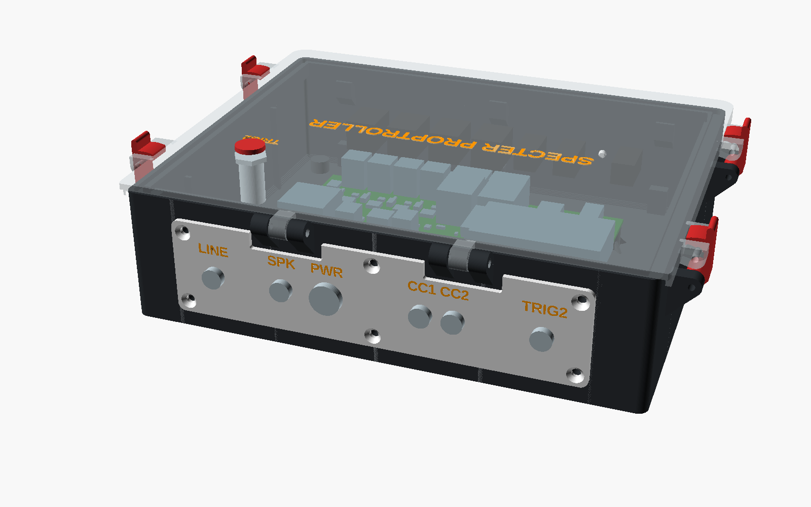

# Enclosure

A 3D-printed box for the Spectre Proptroller board, for a Bambu Lab X1C with an AMS, **printed in ASA** (owner
2026-10-20: PLA and PLA-CF are too brittle and soften in a sun-warmed box):
- the board on 10 mm standoffs;
- panel-mount jacks in two flat faceplates, front and back, located by guide pins and **screwed on with six M3s each**
  (the default) or glued on, with labels inlaid in a second colour;
- a lid on a printed hinge, sealed on a silicone bead and drawn down by four cam latches;
- a flat floor on the bed, with a boss in each corner for a screw-on rubber foot.

There is also an **AC case** for rev B boards only, an advanced option: a bigger box with one 120 V duplex receptacle on
the front, switched by the two relays, and a screwed cover over its mains bay (**AC case (advanced)**, below). For most AC
loads the off-board relay-controlled outlet box is the better route (`../docs/ac-control.md`).

The model is `proptroller-print.scad` (OpenSCAD). It reads `params.scad`, which `tools/print_params.py` writes from
`design.toml` and the board (`../hardware/kicad/proptroller.ir.json`; `board-parts.json` holds the board's parts as boxes,
for the assembled view and the AC case's barrier).




## Variants, and which to choose

Every combination is built every time, its name spelled out:

| Case | Hinge | Plates | Tub | Plates | Project |
|---|---|---|---|---|---|
| standard | printed pin | **screwed (default)** | `stl/tub_screws.stl` | `stl/plate_front_screws.3mf`, `stl/plate_back_screws.3mf` | `specter-case-screws.3mf` |
| standard | printed pin | glued | `stl/tub_glue.stl` | `stl/plate_front_glue.3mf`, `stl/plate_back_glue.3mf` | `specter-case-glue.3mf` |
| standard | Everbilt | screwed | `stl/tub_everbilt_screws.stl` | as screwed above | `specter-case-everbilt-screws.3mf` |
| standard | Everbilt | glued | `stl/tub_everbilt_glue.stl` | as glued above | `specter-case-everbilt-glue.3mf` |
| AC (rev B only) | printed pin | screwed | `stl/tub_ac_screws.stl` | `stl/plate_front_ac_screws.3mf`, `stl/plate_back_ac_screws.3mf` | `specter-case-ac-screws.3mf` |
| AC (rev B only) | printed pin | glued | `stl/tub_ac_glue.stl` | `stl/plate_front_ac_glue.3mf`, `stl/plate_back_ac_glue.3mf` | `specter-case-ac-glue.3mf` |
| AC (rev B only) | Everbilt | screwed / glued | `stl/tub_ac_everbilt_screws.stl`, `..._glue.stl` | as above | `specter-case-ac-everbilt-screws.3mf`, `-glue.3mf` |

The lids follow the case and hinge (`stl/lid.3mf`, `stl/lid_everbilt.3mf`, `stl/lid_ac.3mf`, `stl/lid_ac_everbilt.3mf`);
the latches are the same for all; the AC case adds its mains-bay cover (`stl/cover_ac.3mf`). The screwed plates' printed
TPU gaskets, if you seal with them, are their own projects: `stl/gaskets.3mf` (standard) and `stl/gaskets_ac.3mf` (AC).
The panel USB-C port the other way round from `design.toml` (off by default) is `stl/tub_usb.stl` and
`stl/plate_back_usb.3mf`, with the default mount.
`[plates] mount` in `design.toml` only picks what the model shows when you open it; `[case] ac` the same for the case.

**Which to choose.**
- **Screwed (the default).** The plate comes off again: six countersunk M3 × 12s (or pan heads, `[holes] screw_head_type`) through the wall into hex nuts in pockets on the bosses behind it (2026-10-22: nuts are easier to get than heat-set inserts; `[holes] plate_nut` "M3" or "#4"), sealed in
  the groove round its back. Choose it if the plate's layout may change, if you may want to reprint a plate, or to get at a
  jack's back from outside. It comes off with the lid open: the DC jacks' nuts inside hold it too (**Taking a screwed plate
  off**). The cost: 12 nuts and screws, and a seal that has to cope with the plate bowing between six
  screws (**Sealing a screwed plate** below: closed-cell EPDM foam tape first, then butyl tape, wet silicone, soft tubing or the printed TPU gasket in a
  3.5 × 1.6 mm groove that runs along the screw rows; never a cured silicone bead, and nothing that glues the plate on).
- **Glued.** The plate bonds to the wall for good: the seal is one continuous bead with no screw holes, and the plate is flat
  because it is bonded all over. Choose it for a box that stays as it is. A glued plate makes it impossible to change the
  plate's layout (move a jack, add one, take a different size) or to replace a damaged plate without prising it off, which
  will likely mark the wall; screws allow all of that.
- **Replacing a jack** works with either, without the plate coming off; checked against the model:

  | Jack | Which side | Glued plate | Screwed plate |
  |---|---|---|---|
  | 3.5 mm TRS (TRIG1/2, RLY1/2, CC1/2, SPK, LINE) | nut on the show face, body inside; the wall window (11 mm) clears its 9.8 mm round back (owner 2026-10-22: the 9.2 mm window was too small), and the plate is counterbored from its back to the window's width, leaving 1.75 mm where the jack seats (`[plates] j35_seat`, owner 2026-10-21: the thread is short), so more thread reaches the nut | open the lid, unsolder (or unplug) its lead, unscrew the nut outside, pull the jack into the box; the new one goes in from inside and its nut on outside | the same; or take the plate off (**Taking a screwed plate off**) and do it on the bench |
  | DC barrel (OUT1–4, PWR) | flange on the show face, **nut inside, on the wall's inside face** (the default): the thread passes plate and wall through a 13.2 mm window, and the nut clamps both | open the lid, unsolder its leads, undo the nut inside with a 15 mm open-end spanner (the nut is on the open inside face; at 19.7–20.2 mm pitch a socket barely clears the next nut), pull the jack out through the front; the new one goes in from the front and its nut on inside | the same |
  | AC receptacle | strap behind the wall, three #6-32s from the show face | cover off, unwire it, the three screws out, lift it out of the bay | the same |

  **The DC jacks need a thread of 8.5 mm or more** for that (plate 3 + wall 2.4 + the nut): the owner's measure 9.0 mm
  (2026-10-21, `[parts.dcp] thread_l`, asserted), leaving 3.6 mm past the wall's inside face for the nut (a thin M12 × 0.75
  nut is about 2–2.5 mm): the window through the wall is only 13.2 mm, so the nut seats flat on the wall's inside face,
  with no recess behind it; keep guide pins and their holes off the windows' corners (2026-10-22: a pin hole beside OUT4
  left too thin a web, which printed out of shape onto the nut). With a shorter
  thread, `[parts.dcp] behind_d = 17.5` would let the window clear the nut across its corners (17.3 mm for a
  15 mm nut, `nut_c`, `assumed`) with the nut on the plate's back inside the window, but at 18.7 mm the windows push the
  back plate's seal into its top screws (2026-10-22): it doesn't build as the plates stand. That leaves no room for a tool in a
  window only 2.4 mm deep, so the nut is turned by hand or with the plate off. Neighbouring DC jacks are at least
  `nut_c` + 1.5 mm apart (20.2 mm on the standard front, 19.7 on the AC front; asserted), and every rib between windows at
  least 1.5 mm (asserted).

## Changing the design

**Everything starts from one file: `design.toml`.** It runs in order:
1. **Your parts:** the caliper readings.
2. **Fits:** clearances.
3. **Holes:** derived from 1 and 2. Set one here to override it.
4. **Box.**
5. **Connectors:** each panel jack's wall, kind, position and label.
6. **Faceplates:** how they're held (`mount`), the guide pins, the seal groove, the screws, the labels.
7. **Seal.**
8. **Lid.**
9. **Hinge.**
10. **Latches.**
11. **Text.**
12. **AC case:** the `[ac]` tables, which override the sections above of the same name.

Change a value, then run `tools/print_build.sh`. That rebuilds every STL, every `specter-case-*.3mf` project, and
`params.scad` / `params.json`, which the model reads. It stops if any part has a layer printed on air (see **No supports
anywhere**), or if an assert in `tools/print_params.py` or the model finds two parts in each other's way.

| To change | Edit in `design.toml` | What follows |
|---|---|---|
| every panel-mount cutout | `[parts.dcp] hole_d` (DC barrel, 12) and `[parts.j35p] hole_d` (3.5 mm, 8); `behind_d`: what sits behind the plate (the DC jack's nut) | each cutout of that kind on both plates, and the wall windows behind them |
| a connector's place, label, or a new one | `[connectors]`: `face`, `kind` (`j35`, `dc`, `usb`), `x`, `label`; `enabled = false` leaves one out | its cutout, wall window, label and the plate's length |
| the panel USB-C port (off by default) | `[connectors] USB` `enabled = true` | the back plate's USB cutout, window and label |
| the USB and button holes' fit | `[fit] hole_fit`, or `[holes] usb` / `button` outright | those holes |
| how the faceplates are held | `[plates] mount`: `"screws"` (the default) or `"glue"` | only what the model shows: both are built |
| the screws | `[plates] screw_layout`: `"six"` (the default: left, middle, right along top and bottom) or `"pitch"` (advanced: as many as keep each gap within `screw_pitch`) | the screw rows, the insert bosses |
| the guide pins | `[plates] pin_d`, `pin_l`, `pin_wall`, or `pins` to place them by hand; their play `[fit] pin_clr` | the pins on both plates and their wall holes |
| the screwed plates' seal groove | `[plates] sg_w`, `sg_d` (3.5 × 1.6), `sg_m`, `sg_land`, `sg_edge`, `sg_round`; the TPU gasket's section `[gasket]` | the groove's path round the screws, the bottom screw row (lowered if a bend round a screw would reach a window), the TPU gaskets; then `plate_fea.py --fill` and `--seals` |
| the plate screws and nuts | `[holes] plate_nut` ("M3", or "#4" with `[box] boss_w` 11, `boss_h` 9.2, `boss_len` 4.3), `screw`, `screw_head`, `screw_head_type` ("flat" countersunk or "pan") | every boss's nut pocket and plate countersink |
| the board standoffs | `[holes] standoff`: 4.0 for a heat-set insert, 2.6 for a self-tapping screw | all four |
| the pin size | `[holes] pin`: 3.3 for M3 or #4 (`pin_pilot` 2.5 for the far knuckle or ear it threads into), 1.9 for filament | hinges and latches |
| the screw length for hinges and latches | `[hinge] pin_span` (20.4: M3 × 20 or #4 × ¾ pan head) | the knuckles' length, the latch ears' and lugs' thickness |
| the latches | `[latch]`: `latch_in` (from the corners), `latch_bite` (squeeze), `latch_detent`, `latch_travel` | the levers, tub ears and lid lugs |
| the box's size | `[box] clear_front`, `clear_back`, `clear_left`, `clear_right`, `inner_h` | walls, floor, ribs, lid, latches |
| the lid text | `[text] title` | every lid |
| the AC case (advanced, rev B only) | `[ac]`, `[ac.*]`, `[parts.outlet]`, `[parts.gland]` | the AC parts (**AC case (advanced)**) |

## In Fusion, SolidCraft or another CAD program

`fusion/SpecterEnclosure/` is a Fusion script that builds the standard case (screwed faceplates, printed-pin hinge, cam
latches) as a parametric Fusion design, from the same sizes as `proptroller-print.scad`. `tools/fusion_check/check.sh
cad` builds the same timeline in SolidCraft (`cad/specter-enclosure.solidcraft`) and a solid STEP assembly
(`cad/specter-enclosure.step`), and compares every part with the OpenSCAD model. How to run it, what follows a
parameter change and what was checked: `fusion/README.md`.

## Printing

**ASA, every part** (owner 2026-10-20), the standard case included. No carbon-filled filament for the AC case.

**Easiest: open a project file in Bambu Studio** (File → Open Project): the table above names them. Plates, laid out as
you arranged them (2026-10-21, fewer plate changes): the standard case on **two plates**, 1 the tub with the four latches
(turned 90°, along the left edge) and the back faceplate, 2 the lid and the front faceplate.
The AC projects keep four (their tub is too big to share a plate): 1 both faceplates and the latches, 2 tub, 3 lid, 4 the
mains-bay cover. The text parts are on filament 2. **The last plate (3, or 5 in the AC projects) is the TPU gaskets**
(2026-10-21: to try them in place of the foam), on **filament 3, TPU 95A**: the lid's gasket ring with, inside it, the
screwed plates' front and back gaskets (a glued-plate project has the lid's alone). When you send it, map filament 3 to
the **external spool** (the TPU 95A profile: too soft for the AMS), and dry the TPU first.

What the projects set: your saved project (`bambu/project_settings.config`, from your 2026-10-21 17:54 save, with the filament
cost zeroed): X1C 0.4 nozzle, **0.20 mm Standard, 2 walls, 15 % infill**, textured PEI, your project filament "Generic ASA - 105c plate"
(`bambu/filament_settings_1.config`: Generic ASA, nozzle 260 °C) on **both ASA slots** (body and inlaid text) and TPU 95A on the third, the **bed at 105 °C** (2026-10-22: 110 °C with a 10-minute heat soak made the bed too sticky and left white marks on the black ASA) and the **exhaust fan at 10 % during the print** (70 % after it; the printer setting "air filtration" (`support_air_filtration`) on, without which Studio neither shows nor sends the exhaust speeds; 2026-10-21: the tub lifted at 100 °C with the exhaust at 70 %), **no brim** on any part (owner 2026-10-22: the recipe holds them now), a **2-minute heat soak** in the start G-code once the bed is hot (exhaust fan off, nozzle at 75 °C; `SOAK_MIN`, ASA plates only), and the **prime tower on** with flushing
into infill, the tower where you put it on each plate (plate 1 front right at 215.8, 36.8; plate 2 at 217, 28.1). On a
plate with text and no room for the tower (the AC lid's), that project turns the tower off and purges in the chute.
**No brim ears now** (2026-10-22): the tub and lid carried four painted ears from 2026-10-21, when the first tub lifted at
its corners; `EARS` in `tools/make_project3mf.py` puts them back (`Metadata/brim_ear_points.txt`, as Bambu Studio saves it).

**Screw zones:** the tub and the lid each carry a modifier named "screw zones" (`stl/zones/*.stl`, from the model's
`zones_tub` and `zones_lid`) round every insert, nut and screw: the plate screws through the wall into their bosses,
the board standoffs, the feet, the latch ears and lugs, the hinge knuckles (or the Everbilt bosses) and the AC cover's
bosses. They print with 6 walls and solid infill (`ZONE` in `tools/make_project3mf.py`)
whatever the project's walls and infill, so the rest can stay light; and their overhangs slower (20 mm/s for 25–50 % of a line width, 15 for 50–75 %), for the hinge gussets' and latch ears' 45-degree undersides (2026-10-21: rough in ASA). Those two speed keys aren't yet confirmed kept by Studio in a modifier: check the zone's settings in the object list. In Bambu Studio they show under the tub and the lid
in the object list; check one in the slice preview (solid round each insert) before trusting them.
`tools/make_project3mf.py` writes them, and checks each plate: every part on the bed, out of the X1C's
front-left exclusion zone (18 × 28 mm), clear of the others where they share a height (the tub's latch ears overhang the
latches 30 mm up), and the tower clear of every part. Your layout moved one thing: the back faceplate 1.6 mm right (centre
x 102.5; 103.4 from 2026-10-22, when the wider 3.5 mm windows made the back plate 1.8 mm longer), out of that corner. What a project can't set:
- Close the door and the top lid, and keep the room free of drafts; the screen shows the chamber's temperature (about
  40 °C or more is the aim);
- pick your real second ASA filament (or sync the AMS): filament 2 is white.

Save new settings from Bambu Studio and copy its `Metadata/project_settings.config` over `bambu/project_settings.config`
(zero `filament_cost`) to keep them, and a project filament's `Metadata/filament_settings_1.config` over
`bambu/filament_settings_1.config` (without it Studio puts the slots back on a system preset when it opens the project). If the save is on ASA it is taken as it is; otherwise the projects put Bambu's ASA
values (`bambu/asa.json`), a 105 °C bed and the exhaust low on both slots, and no brim. A new arrangement goes in
`LAYOUT` and `TOWER` at the top of `tools/make_project3mf.py` (footprint centres, a turn in degrees, the tower's corner).

**The fit coupons first:** `stl/coupons.3mf`, one plate on ASA, no brim: the seal coupon and both mount coupons
(the mount coupon's wall piece stands 34–47 mm tall on a small first layer: if it tips, add a brim to it in Studio).

**The TPU gaskets, in TPU 95A,** are the case projects' last plate (above), and also projects of their own:
`stl/gaskets.3mf` (the lid's ring with the standard front and back gaskets inside it) and `stl/gaskets_ac.3mf` (the AC
ones), one plate each, one filament; each gasket alone too (`stl/gasket_*.3mf`). They are for a lid or a screwed plate
sealed with the printed gasket in place of the foam (**Seal (the lid)**, **Sealing a screwed plate**). What
the projects set: the same saved process, on the values of Bambu Studio's "Bambu TPU 95A HF @BBL X1C" profile
(`bambu/tpu95a.json`: 230 °C nozzle, 35 °C bed, 12 mm³/s at most), Arachne walls (the lip is a single 0.45 mm line, which
the classic wall generator may drop) and no brim. The TPU 95A profile notes it is too soft for the AMS: **feed it from the
external spool**. Dry it first (TPU takes up water and then strings). Each gasket is 2.4 mm tall: a 2-layer base and a
10-layer lip that leans 0.25 mm a layer (51° from upright: each 0.45 mm line overlaps the one below by 0.2 mm), a steep
overhang for TPU; check in the slice preview that every lip layer is there all round, print slowly with the part fan on,
and **print a short length first** (`stl/gasket_back.3mf`, cut off in the slicer) and try it on the mount coupon. Not
sliced in Bambu Studio yet.

**Shrinkage.** ASA shrinks a little more than PLA as it cools (roughly 0.5 % against 0.3 %). Nothing in `design.toml` was
changed for it:
- the holes are small, so 0.5 % is a few hundredths of a millimetre on them: inside `hole_fit` and the listings' play;
- the guide pins (Ø4) and their holes (Ø4.3) shrink alike, both ASA, so `pin_clr` stays 0.15; try it on the mount coupon;
- heat-set inserts melt their own seat, so the 4.0 mm insert holes stay;
- the tub and the plates shrink together, so the plates still land on their windows.

The one long dimension that matters is the board's standoff spacing (126 × 72 mm): 0.5 % is 0.6 mm over 126. Measure it on
your first tub; if it comes out more than 0.3 mm short, set the filament's Shrinkage in Bambu Studio (for example 99.5 %)
rather than changing the model.

The single parts, if you'd rather build your own plates. The `.3mf` ones are small projects on the same settings, the text
already on filament 2:

| Part | File | Pose | Notes |
|---|---|---|---|
| Tub | `stl/tub_screws.stl` (and the others above) | floor down | 199.8 × 160.8 mm, 53 mm to the rim (222.7 × 170.1 with the latch ears and knuckles). AC: 209.8 × 202.8, 70 mm to the rim (232.7 × 212.1) |
| Lid | `stl/lid.3mf` (lid + text) | top face down | the title and TRIG2 are inlaid 0.4 mm on the bottom layers, on filament 2 |
| Front plate | `stl/plate_front_screws.3mf` | show face down | a flat 3 mm plate, 159.9 × 41.1 mm screwed (27.6 glued), its two guide pins standing up off its back: TRIG1, RLY1 and RLY2 8 mm (3.5 mm TRS), OUT1–4 12 mm (DC). Labels inlaid on the bottom layers, with the relay jacks' wiring key (`T=NO R=NC S=COM`) under RLY1 and RLY2 |
| Back plate | `stl/plate_back_screws.3mf` | show face down | 158.8 × 38.1 mm screwed (27.4 glued), notched under the hinges: LINE, SPK, CC1/2, TRIG2 8 mm, PWR 12 mm |
| AC front plate | `stl/plate_front_ac_screws.3mf` | show face down | 199.2 × 60.2 mm screwed (48 glued): the receptacle's openings, TRIG1, OUT1–4, the rating |
| AC cover | `stl/cover_ac.3mf` | top face down | 102.6 × 88.5 mm, 44 mm tall with its chimney; `UNPLUG CORD BEFORE OPENING` inlaid on filament 2 |
| Latch lever ×4 | `stl/latch.stl` | on its side | |
| TPU gaskets (screwed plates, optional) | `stl/gaskets.3mf`, `stl/gaskets_ac.3mf` (`stl/gasket_front.stl`, `gasket_back.stl`, `gasket_front_ac.stl`, `gasket_back_ac.stl`, `gasket_back_usb.stl`) | flat, lip up | TPU 95A on its own, from the external spool: 155.1 × 35.1 (front), 153.9 × 32.1 (back; the AC back's is the same size, its dips under the hinges elsewhere; 153.9 × 34.9 with the USB port), 195.5 × 54.2 mm (AC front), 2.4 mm tall |
| **First:** seal coupon | `stl/coupon_seal.stl`, in `stl/coupons.3mf` | as printed | 40 mm of the left wall's rim round the first latch (land, groove, latch ears) and that corner of the lid (tongue, skirt, keeper lugs): try a lever, its two screws and the bead before the tub |
| **First:** mount coupon | `stl/coupon_mount_screws.stl` (`coupon_mount_glue.stl`), in `stl/coupons.3mf` | as printed | the front wall's right-hand end (the OUT4 window, a guide-pin hole, the nut bosses) and that end of the front plate with its pin: try the pin's fit (`pin_clr`), the nuts in their pockets, turning a DC jack's nut inside the box, and your seal (butyl strip, silicone, tubing or a piece of the TPU gasket) or adhesive before the tub. It has one pin, so it tests the fit, not the one-way-round. The wall piece stands on a 2.4 mm edge: the project brims it |

**No supports anywhere.** `tools/overhangs.py` slices every STL in its print pose every 0.2 mm, as the printer lays it,
and checks that each layer stands on the one below: within 0.3 mm (a 45° wall moves 0.2 mm a layer) of material that is
itself held up, all the way down to the bed. What's left is a **ledge** (within 0.5 mm of support), a **bridge** (on a
straight line that ends on support at both ends, at most 30 mm), or an **island**, which would print on air:
`tools/print_build.sh` fails on any island. On the parts it finds:
- **Bridges** (all on the tubs unless named):
  - the window tops: 6 mm (3.5 mm jacks), 10.1 mm (DC jacks), 12.8 mm (USB, `tub_usb.stl` only);
  - the guide-pin holes' roofs, 1.3–1.5 mm; the rubber-foot pilot holes' tops, 2 mm; the M3 insert holes' tops, 1.2–1.5 mm;
    the Everbilt pilot holes, 1.2 mm; the lid's text pockets' ceilings, up to 2 mm;
  - AC case: the curtain over the relay window, 27.2 mm; the receptacle's face windows, up to 26.2 mm; the tie points'
    slots, 4.7 mm; the gland hole's top, 8.3 mm; the #6-32 holes' tops, 1.4 mm. The cover: 1.4 mm.
- **Small ledges:** the 0.2 mm steps of the chamfers, the countersinks, the knuckle bores. `python3 tools/overhangs.py -v stl/tub_screws.stl` lists them.
- No islands on any part (44 parts, the five TPU gaskets included, 2026-10-21).

**Rubber feet.** Screw one into each corner boss from underneath: blind 2.5 mm pilots, 7 mm deep (M3 self-tapping or #4
screws). **A foot screw may go at most 7 mm into the boss** (its length less the foot's thickness under the head): the cap
over the pilot is 1 mm in the standard case and 4 mm in the AC case, where the front left foot is under the mains bay
(`feet_cap`, asserted at least 1 mm). An 8 mm screw through a 1 mm foot is the limit.

**Rebuilding.** `tools/print_build.sh` rebuilds every STL and 3MF, the OpenSCAD renders in parallel (about two minutes).
It also checks each one: closed and manifold, lowest z = 0, no islands. The STLs and projects aren't in git, so run it
after a fresh clone or after changing a number.

## Hardware

| What | Qty | For |
|---|---|---|
| M3 heat-set insert, M3 × 5.7 short (Ø4.0 hole) | 4 | board standoffs. For self-tapping M3 screws instead, set `[holes] standoff = 2.6` |
| M3 × 6 pan head | 4 | board onto the standoffs |
| M3 × 20 pan head, or #4 × ¾ in pan head | 2 | hinge pins: in from the hinge's outer end (towards the nearer side wall, where a screwdriver has room), clear through two knuckles, threaded into the one nearer the middle (no nut). A flat-head #4 × ¾ is measured overall and is about 1.7 mm short: use pan heads |
| M3 × 20 pan head, or #4 × ¾ in pan head | 8 | the latches: a pivot through each lever's tub ears and a keeper across each pair of lid lugs, each in from the corner's side, clear through the thick ear or lug (6 mm) and tapping its own thread in the thin one's undersized 2.5 mm hole (3.6 mm, towards the wall's middle): no nuts |
| Rubber feet, screw-on, with M3 or #4 self-tapping screws (at most 7 mm into the boss) | 4 | one in each corner boss under the floor |
| Screwed plates, optional: M3 hex nut (DIN 934, 5.5 mm across flats), or #4-40 (¼ in) with `plate_nut = "#4"` | 0–12 | six behind each plate, each in the pocket on its boss's inside end (AC case: the front plate's bosses in the mains bay take M3 × 5.7 heat-set inserts instead, set from outside, so no nut or screw end is in the bay) |
| Screwed plates: M3 × 12 flat head, 90° countersunk (ISO 10642 / DIN 7991, stainless), or pan heads with `screw_head_type = "pan"`; #4-40 × ½ in with #4 nuts | 12 | through the plate (3), then tapping its own thread in the wall and boss (2.4 + 4.75, an undersized 2.5 mm hole: `[holes] plate_pilot`), and into the nut if you fit one, about 2 mm past it. AC mains-bay inserts: M3 × 8 |
| Screwed plates: the seal | 0.72 m (AC case 0.83 m) of strip or tubing | one of, best first: **closed-cell EPDM foam tape 1/8 in (3.2 mm) thick, slit to 3.5 mm**; butyl tape 1/8 in thick cut into 2 mm strips (or Ø3 mm butyl rope); neutral-cure silicone, screwed down wet; 0.8 × 2.4 mm (1/32 × 3/32 in) soft silicone tubing; the printed TPU 95A gasket (`stl/gaskets.3mf`). In the 3.5 × 1.6 mm groove round each plate's back: **Sealing a screwed plate** |
| Glued plates: adhesive | | gel CA for tack, a sealing adhesive for the groove, or acetone: **Glue** |
| Panel-mount female DC barrel jack, 12 mm cutout, nut inside, **thread 8.5 mm or longer** | 5 | OUT1–4, PWR |
| Panel-mount 3.5 mm **stereo (TRS)** jack, 7.8–8 mm cutout | 8 | TRIG1, RLY1, RLY2, LINE, SPK, CC1, CC2, TRIG2 (the AC case: 6, no RLY jacks). Three conductors: TRIG1/TRIG2 and the relays use all three. If yours is the switched 5-lug kind, wire only the T, R and S lugs |
| Optional: panel-mount USB-C extension (nut, 12 mm thread) | 0–1 | only with `[connectors] USB` `enabled = true` |
| Closed-cell EPDM foam tape, 1/8 in (3.2 mm) thick, 1/4 in wide, adhesive-backed | ~2 m (AC ~2.3 m) | the lid's seal (slit to 3 mm) and the screwed plates' (slit to 3.5 mm): search "closed-cell EPDM foam tape 1/8 inch" |
| Neutral-cure silicone (clear, outdoor) | 1 tube | sealing the jacks, and the fallback seals (the lid's formed-in-place bead, a plate screwed down wet) |
| APIELE 10 mm metal momentary push button, IP65, pre-wired (sold in 5-packs) | 1 | TRIG2 on the lid: 10.2 mm hole through the 2.4 mm lid, nut underneath |

The AC case's own parts are in its section.

## USB

The panel USB-C port is **off by default** (`[connectors] USB` `enabled = false`): the back plate has no USB cutout, window
or label. Reach the DevKit's or Pico's own USB by opening the lid: it is on the module, inside, at the module's end toward
the board's centre (by relay K1). In the AC case, unplug its cord before opening the lid. The panel-mount USB-C extension
is optional: set `enabled = true` and rebuild, or print `stl/tub_usb.stl` and `stl/plate_back_usb.3mf`, which the build
always makes.

## Relay outputs (RLY1, RLY2)

In the standard case each relay comes out on a 3.5 mm TRS jack, the same panel-mount part as the other 3.5 mm jacks
(`[parts.j35p]`). The owner's wiring, from the board's relay terminal (silk `NO COM NC`) to the jack:

| Jack contact | Relay terminal | Plug (a TRS cable) | Rating through the jack |
|---|---|---|---|
| tip | NO | tip | **0.3 A, 30 V DC at most** (the jack's contacts, below) |
| ring | NC | ring | the same |
| sleeve | COM | sleeve | the same |

The front plate carries the same key under the two jacks: `T=NO R=NC S=COM`. A device to be switched on wants tip and
sleeve (closed while the relay is on); ring and sleeve are closed while it is off.

- **Rating: the jack's, not the relay's.** Through the case, a relay output is only as good as the 3.5 mm jack it goes
  through. The panel jack's own listing or datasheet isn't recorded here, so its contact rating is unknown. Comparable
  3.5 mm TRS jacks are rated 0.3 A at 30 V DC (Tensility 54-00081, panel mount), 1 A at 12 V DC / 12 V AC (Schurter
  4802.2300, panel mount) and 1 A at 12 V DC (Same Sky SJ1-3513, a PCB part): those figures are from distributor listings
  as search results showed them (2026-10-20), not checked against the makers' datasheets. Treat RLY1 / RLY2 through this
  case as **0.3 A, 30 V DC at most**, the lowest of them (`[parts.j35p] rating_a`, `rating_v`, marked `assumed`) until you
  have your jack's own datasheet. That is plenty for a contact closure into another controller, a fog machine's remote
  input or a small DC coil; for anything heavier, wire it to the board's relay terminal directly (rev B: 28 V DC 10 A or
  120 V AC 5 A, 3 A inductive, `../hardware/README.md`), not through the jack.
- **Plugging in and out bridges the contacts.** A TRS plug sliding in or out wipes its tip past the ring and sleeve
  springs, so for a moment it can join COM and NO (or NC) and fire whatever is connected. Plug in before power-up, and
  unplug with the show stopped.
- **Never mains on a 3.5 mm jack.** Not on either board revision, not through this case: the jacks, plugs and cables are
  low-voltage parts with exposed metal when unplugged. To switch 120 V AC, use the off-board relay-controlled outlet box
  (`../docs/ac-control.md`, driven from an OUT, RLY or CC output: the recommended route) or, on a rev B board only, the
  **AC case (advanced)** below.

## AC case (advanced)

**Rev B boards only. Never a rev A board.** This is the advanced option. The recommended way to switch 120 V AC from a
Proptroller is the off-board relay-controlled outlet box, driven from an OUT, RLY or CC output, which keeps mains out of
this box altogether: `../docs/ac-control.md`. Build the AC case only if you know mains wiring, or have someone who does
wire it.

**Owner decision (2026-10-20): the AC case is accepted as designed,** with the screwed mains-bay cover and its `UNPLUG CORD
BEFORE OPENING` warning, and the owner accepts the risk that remains (below: a printed barrier and cover are not a rated
enclosure, the receptacle faces are open to water, and the rating rests on the board's design margin, not a
certification). A `GFCI OUTLET ONLY` label is not decided yet: its place is kept free on the cover, right of the warning.





What it is: the standard case made 42 mm deeper at the front (`clear_front` 80), 10 mm wider on the right (`clear_right`
40) and 17 mm taller (`inner_h` 68), with
- a 3-prong cord coming in through a cable gland in the left wall;
- one duplex NEMA 5-15R receptacle on its side on the front plate, its hot-side tab split so that RLY1 switches the left
  outlet and RLY2 the right one (each 120 V AC 5 A, 3 A for an inductive load: the rev B relay rating);
- a printed barrier wall between the mains bay and the low-voltage side, overlapping ribs on the lid;
- a **screwed cover** over the whole mains bay and the relay terminals;
- the rating inlaid under the receptacle, permanently: `120VAC 5A (3A IND) per outlet`, and `AC CASE: REV B BOARD ONLY`
  on the lid;
- TRIG1 and OUT1–4 on the front plate right of the bay; no RLY1 / RLY2 jacks. The back plate is the standard case's.

Screwed or glued plates, printed pin or Everbilt hinge: all four are built. Its numbers are the `[ac]` tables at the end of
`design.toml`; the receptacle and gland are `[parts.outlet]` and `[parts.gland]`.

### AC design choices

- **Cord through a gland, not an IEC inlet.** A 3-prong cord (a NEMA 5-15P plug moulded on, 14/3 or 16/3 SJT) comes in
  through an M20 nylon cable gland in the left wall (a 20.5 mm teardrop hole, its point cut flat: a round hole's last
  layers would print on air). The flat top's corners are 11.1 mm from the hole's centre, which may be outside the gland's
  O-ring or sealing washer: **put a thin ring of neutral-cure silicone round the hole on the wall's outside face** before
  you fit the gland, or check that your gland's seal covers a 23 mm circle. The
  gland grips the cord's jacket, so it is the strain relief. Chosen over a panel IEC C14 inlet with a fuse drawer because
  it is what the owner described (an outlet and a 3-prong plug), a round hole prints clean in an upright wall where the
  inlet's rectangular cutout has to be held to a few tenths and its snap-in clips are made for 1–2 mm sheet, the
  conductors go straight into lever connectors (the inlet's 6.3 mm tabs want crimped quick-disconnects), and the inlet's
  one fuse would serve both outlets. The cost: the cord is part of the box. The gland sits 102 mm from the board's back
  edge and 19.5 mm up: its locknut clears the floor fillet, its cap the front left latch's ears (asserted), and the end
  walls' front ribs sit 60 mm from the wall's middle to clear the locknut (`[ac.box] ribs`).
  - **The cord must fit the gland:** its outer diameter inside the gland's clamping range (6–12 mm for the one listed), and
    its jacket running at least 10 mm in past the locknut before the conductors fan out.
- **The receptacle.** A standard duplex receptacle (two round-ended faces), not a Decora one: on its side, each face's
  wall window is a bridge under 27 mm printed upright, where a Decora's single 67 mm face would need a 67 mm bridge. The
  front plate is the wallplate: an opening per face (a standard duplex wallplate's 1.343 × 1.125 in, 0.25 mm all round),
  38.1 mm apart.
  - **Mounting.** Snap the plaster ears off the strap. The strap lies on the wall's inside face, its faces through the wall
    windows and the plate's openings, held by three #6-32 flat heads countersunk in the show face: the middle one is the
    faceplate screw, into the strap's tapped hole between the faces, and one goes through each of the strap's two
    mounting slots, 83.3 mm apart, with **a lock washer and nut** behind (take the strap's own captive screws out).
  - **Face depth: measure it.** The faces should come out flush to 0.5 mm proud of the plate: a recessed face gives the
    plug's blades a poor grip. Measure how far yours stand in front of the strap (`[parts.outlet] face_proud`, `assumed`
    at 5.65 mm) and rebuild: the model then sets the strap that much in a recess in the wall's inside face, or out on
    pads, so the faces stand `[ac] face_set` (0.25 mm) proud. Screw lengths change by the same amount.
  - **Back-wire only.** On its side, a side-wire receptacle's lower terminal screws face the floor with only 7–9 mm under
    them, less than a 14 AWG bend's 15 mm radius: use a **back-wire (pressure-clamp) receptacle**, its wires leaving the
    back of the body.
  - **Stops.** A printed post from the floor behind each end of the strap, between the body and the slot's nut, 0.3 mm off
    the strap's back (`ac_stops`, asserted clear of both): pushing a plug in can't push the strap off the wall, where its
    three screws hold it only in tension.
  - **Room.** The body reaches 31 mm in behind the strap (`body_d`, not measured), clear of the floor fillet and of the
    rim land's underside, with 8 mm or more over it for its terminal screws and wires under the cover (asserted). The bay
    is about 105 × 45 mm in plan behind the body: room for three or four lever connectors (Wago 221 class), the two fuse
    holders, and 14 AWG bends of about 15 mm radius or more.
- **Earth.** A green wire from the cord's ground straight to the receptacle's green screw (through a lever connector if
  you like); nothing printed carries it. The strap is earthed through that screw, and with it the three metal screw heads
  on the show face. **Lock washers** under the two outer strap screws keep that contact.
  - **The earth wire to H3: the earth wire's ring terminal goes under H3's screw (the board's plated earth point, tied to
    GND); in the AC case it is required** (`../hardware/README.md`, SAF-2). H3 is the board's front left mounting hole
    (`[ac] earth_point`); without the wire the board isn't earthed, so the AC case always has it. Run a green **18 AWG**
    stranded wire (300 V insulation, 2.2–2.8 mm over it) from the receptacle's green screw (or from a lever connector on
    the cord's earth) through the 3.2 mm hole in the front wall of the **earth niche** (`earth_hole`; crimp the M3 ring
    terminal on after threading the wire), and seal the hole round the wire with a dab of neutral-cure silicone, so no gap
    round it is wider than the barrier's 0.5 mm. The niche is a small low-voltage bay the edge wall steps forward round,
    between the left end of the edge wall and TRIG1's pocket (`earth_niche` 6 mm deep): the board's front edge is only 5 mm
    from H3's row, too tight for the wire to turn in, so the wire comes in heading back, runs 5 mm, turns east on a 6 mm
    radius (`earth_bend`, about 2.5× its diameter) over the board's edge, and runs on to the ring terminal's crimp 17.5 mm
    west of H3 (`earth_west`): the terminal (15–20 mm long with its crimp) lies flat on H3's pad, its tongue pointing west,
    as `../hardware/README.md` asks. Pre-bend the wire before you fit the board. Stack at H3, from the head down: an
    **M3 × 8** pan head, a **split or Belleville lock washer**, the ring terminal, the pad, the standoff: the lock washer
    keeps the contact as the plastic standoff creeps, as at the receptacle's strap screws. The wire is in the bay up to the
    niche; inside it, and its last 17.5 mm along the board's edge, it is on the low-voltage side, clear of TRIG1's pocket.
    The cover is cut round the niche (0.5 mm off its walls), and the lid's ribs overlap its walls like the rest of the
    barrier.
  - **The second earth lead, to H2: also required whenever a relay carries mains** (hardware 3ec6fe1: K2's side reaches
    H3's copper only through 1.9 mm, so H2, the board's back right mounting hole, is a second plated earth point on GND;
    its pad is on both faces and touches its standoff). A second green 18 AWG wire from the receptacle's green screw (or
    the lever connector on the cord's earth) leaves the bay through a 3.2 mm hole in the barrier's right wall, 8 mm in
    front of the edge wall (`[ac] earth2_point`, `earth2_back`; seal it round the wire with a dab of silicone), runs east
    in front of the board's front edge to the board's right side, back along it to H2, and onto H2 with an M3 ring
    terminal, its tongue pointing east (off the board's right edge): from the head down an **M3 × 8** pan head, a **split
    or Belleville lock washer**, the ring terminal, the pad, the standoff. About 0.25 m; dress it along the board's edges,
    clear of the board's parts, and tie it to a wall rib. Like the first lead it is on the low-voltage side past the
    barrier, at GND's potential. With the bond in place the low-voltage metal you can touch (jack sleeves,
    the DC jacks' shells, the module) has an earth path if a mains fault ever reaches it, so the GFCI trips. Hum on LINE
    OUT from an amplifier that is earthed too is fixed with a plug-in 3.5 mm ground-loop isolator (transformer type) on
    LINE OUT; never by leaving the earth wire off.
- **The barrier.** A 2 mm printed wall from the floor up to 3 mm past the bottom of the lid's ribs (`[ac] overlap`), with a
  1.6 mm rib on the lid's underside on each side of it, 0.5 mm off it (`rib_gap`), so a stray strand can't cross over the
  top: it would have to go up, over and down through two 0.5 mm gaps. The lid's own rib grid is cut where it crosses the
  barrier. **Check on the first print** that the lid closes: tub and lid shrink a little differently, and 0.5 mm is tight.
  If the lid won't seat, a rib is landing on a barrier top: trim that rib, or make `rib_gap` 0.8 and rebuild. It runs:
  - along the board's front edge, 1 mm off it, from the left wall;
  - round a pocket in front of the board's TRIG1 jack (J_T1), 34 mm deep and 4 mm wider than the jack each side:
    low-voltage room for the end of TRIG1's lead, open to the board behind it;
  - on to the relay terminals, where the **pass-through** is: a window in front of J_R1 and J_R2 only, from a sill 1 mm
    under the board to a curtain 2 mm over the terminal blocks (its underside rising at 45° to a 27.2 mm flat bridge), the
    curtain stopping under the cover, which closes it above;
  - and from there to the front wall, between J_R2 and J_O1 (OUT1's terminal), which closes the bay's right side.

  The mains bay is everything in front of that wall at the front left: the cord, the gland, the receptacle, the fuses, the
  lever connectors and the relay wiring. The low-voltage side is the rest: the module (and its USB), the TRS and DC jacks
  and their leads, TRIG1's pocket. It is a printed wall that keeps wires apart and fingers off, not a rated insulation
  barrier.
  - **A fin between J_R2 and J_O1 doesn't fit.** The gap between the two terminal blocks is 3.1 mm. Printed in the tub, a fin
    there would stand over the board, so the board couldn't go in; hung from the lid, it would swing forward into the
    curtain as the lid opens (a point 44 mm under the lid moves forward about a third of the way it rises). The barrier wall
    in front of the board edge and the cover's chimney side wall (below) stand between them instead.
- **Tie points.** A block on the floor in front of each relay terminal, with a slot for a cable tie across it under a 2 mm
  roof: tie each relay's conductors together and to its block, close to the terminal, so a conductor that slips out of
  J_R stays in the bay.
- **The mains-bay cover.** A separate printed ASA cover over the whole bay: a 2.4 mm plate, 56.5 mm up, over the
  receptacle's terminal screws, the lever connectors, the fuse holders and the tie points, and on back over the curtain to
  a **hood round J_R1 / J_R2**: two side walls down to 1.5 mm over the board, either side of the terminal blocks, and a
  back wall down to 1 mm over the relays. Five M3 × 8 countersunk screws hold it, into heat-set inserts in bosses on the
  bay's walls (45° undersides), so it needs a tool to come off. `UNPLUG CORD BEFORE OPENING` is inlaid in its top.
  - **It comes out straight up.** The hood's walls straddle J_R with 0.5 mm play, so the cover must lift vertically. Its
    edge stops 0.5 mm inboard of the rim land's inner edge on the left and front walls, and its two left-wall screws sit
    on bosses reaching 12.75 mm in, their heads clear of the land (asserted: every part of the cover inside the land's
    opening, every screw head on the cover and clear of the land, the left wall's ribs clear of the cover).
  - **The strip under the land is a labyrinth:** a shelf on the left and front walls under the land (4.6 mm, its
    underside 45°), its top 1 mm under the cover, and a 1.2 mm lip under the cover's edge, hanging 2.5 mm, 0.5 mm off the
    shelf's edge (`ac_shelf`, `ac_lip`). A strand from the land's edge has to go down 0.5 mm, across under the cover,
    down past the shelf's edge and up round the lip.
  - **Finger protection only, not strand-proof.** With the lid open and the cover on, the gaps left are 0.5 mm round the
    cover's edge (into the labyrinth), 1.5 mm under the hood's side walls (over the board) and 1 mm over the relays under
    its back wall: none takes a finger, so nothing at mains potential is reachable with a finger, J_R's screws included,
    from the low-voltage side or above (checked against the model's sizes, not with a test finger). A loose strand can
    still pass a 1 mm gap: hence the tie points, and tugging every conductor. **The board's mains solder joints (K1, K2,
    J_R1, J_R2) are on its underside, in the low-voltage space under the board**, covered by nothing printed: the board's
    own creepage and the standoffs' 10 mm are what keep them apart (`../hardware/README.md`). The side openings under the
    hood beside K1 / K2, next to J_O1 (about 2.6 × 16 mm), are left open: closing them would need the hood to come down
    onto the board between parts placed for the relays, not checked.
  - **Check on the first build** that the hood doesn't touch the relays or the board: the gaps are from
    `board-parts.json`'s keep-out boxes, and the relays' seating and the printed standoffs' height vary by a few tenths.
    If the cover rocks on its bosses, the hood is touching: trim its walls.
  - It clears the lid (its top is 6 mm under the lid's ribs), the barrier (0.5 mm off its walls), the board (asserted:
    nothing on the board where the hood comes down) and the screwed front plate's top bosses (notched round them), so it
    fits both the glued and the screwed AC case.
- **Screwed plates.** The six-screw front plate's screws and bosses clear the receptacle's strap, its screws and the face
  windows, and the tie points (none had to move); the middle top and bottom bosses join the barrier's right wall, which is
  harmless, and the cover is notched round the top ones. The earth path is the strap's, untouched.
- **Clearances.** Nothing of the AC parts is near the back wall, so the hinges, their gussets and the lid's swing are the
  standard case's. The front plate stays under the lid's drip skirt and on the wall's straight stretch (asserted). The
  TRIG1 and DC jack bodies are right of the barrier wall (asserted). The guide pins sit right of the barrier, clear of the
  strap and the bosses; turned round, one lands on solid wall, so the plate fits one way only (asserted).
- **TRIG1** is the same panel-mount 3.5 mm jack as in the standard case, on the front plate right of the barrier, wired
  the same way as there, only with a longer lead: from the jack, over the board on the low-voltage side (behind the
  cover's hood), to J_T1, whose end sits in the barrier's pocket. It never crosses the mains bay.
- **Material.** ASA. **No carbon-filled filament anywhere in the AC case** (carbon fibre makes the plastic conductive). A
  flame-rated ASA or ASA/PC blend is better if you can get one; the projects use plain ASA.
- **Not splash-proof.** The receptacle's faces are open, so water can get in through them. Keep the AC case dry, under
  cover.

### Parts (generic: search terms)

| Part | Qty | Search for |
|---|---|---|
| Duplex receptacle, NEMA 5-15R, 15 A 125 V, standard (not Decora), **back-wire pressure-clamp (required: no side-wire)**, with a breakaway hot-side tab | 1 | "15 amp duplex receptacle back wire clamp" |
| 3-prong cord, NEMA 5-15P moulded plug, 14/3 or 16/3 SJT (or SJOOW), 6–10 ft | 1 | "replacement power cord 14/3 3-prong pigtail" |
| M20 × 1.5 nylon cable gland with locknut, clamping range that includes the cord's diameter | 1 | "M20 cable gland nylon IP68" |
| #6-32 × 3/8 in flat head machine screw (the faceplate screw) | 1 | |
| #6-32 × 1/2 in flat head machine screw, lock washer, nut | 2 | |
| Inline fuse holder **marked 250 V AC or more**, for 14 or 16 AWG (many "14 AWG inline holders" are 32 V automotive parts: not those) | 2 | "inline fuse holder 5x20 250V" |
| Fuse, 5 × 20 mm, **5 A 250 V AC, ceramic, high breaking capacity**; time-lag (T) if the load is a motor or other inductive load, fast (F) otherwise | 2 + spares | "5A 250V ceramic fuse 5x20" |
| Lever connectors (or wire nuts) rated for 14–16 AWG, 120 V | 3–4 | "lever wire connector 3 port" |
| 14 or 16 AWG stranded wire, **insulation rated 300 V or more** (600 V THHN/MTW or appliance wire), black, white and green; ferrules if stranded wire goes under a screw | ~1 m | |
| Earth wires to H3 and H2: green 18 AWG stranded (300 V insulation, 2.2–2.8 mm over it), an M3 ring terminal for 18 AWG (22–18), an M3 × 8 pan head and an M3 split or Belleville lock washer for each | ~0.6 m, 2, 2, 2 | "M3 ring terminal 22-18 AWG" |
| M3 heat-set inserts (M3 × 5.7) and M3 × 8 flat heads for the cover | 5 + 5 | |
| A 3-light outlet tester with a GFCI test button | 1 | "GFCI outlet tester" |

### Wiring

**Wire it with the cord unplugged. Mains wiring by someone who knows it.** Plug the cord into a **GFCI-protected outlet
only**: required, it is the protection the board doesn't have.

```
 cord (NEMA 5-15P)                    board, rev B (terminal silk: NO COM NC)   duplex receptacle (hot tab broken off)
 line (black)  -- connector --+-- 5 A fuse -- RLY1 COM    RLY1 NO -------------- left outlet, hot (brass screw)   RLY1
                              +-- 5 A fuse -- RLY2 COM    RLY2 NO -------------- right outlet, hot (brass screw)  RLY2
 neutral (white) ------------------------------------------------------------- neutral (silver screw; tab kept)
 ground (green) -------------------------------------------------------------- ground (green screw)
                                      board H3 (plated, on GND) ---- green 18 AWG ---- ground (green screw, or a lever connector)
                                      board H2 (plated, on GND) ---- green 18 AWG ---- ground (the same)
                                      RLY1 NC, RLY2 NC: LIVE while the relay is off (joined to COM): insulated, capped
```

- **Line** to COM of each relay (split it with a lever connector, a fuse in each branch); **NO** of each relay to its
  outlet's hot side (the brass screw); **neutral** and **ground** straight to the receptacle (silver and green screws).
- **NC is live whenever its relay is off**: it is joined to COM, which is line. Leave nothing connected to it, and if a
  wire is there, insulate and cap it.
- **Split the tab.** On the hot side (brass screws, the narrow slot), break off the small metal tab between the two screws
  with pliers, so the two outlets' hot sides are separate. Leave the tab on the neutral side (silver screws) in place.
- **Pigtails first.** Wire short pigtails onto the receptacle before mounting it: once it is in, its lower screws are blind.
  Use a back-wire pressure-clamp receptacle, or ferrules on stranded wire under its screws; **never stranded wire in
  back-stab (push-in) holes**.
- Through the relay window only: the relay wires pass the barrier there, nowhere else. The board's relay terminals take
  24–12 AWG; 16 AWG is enough for 5 A, 14 AWG gives margin. Fully insert and tighten every conductor, then tug it. Tie
  each relay's conductors to its tie point.
- **Insulation rated 300 V or more** on all wiring in or near the bay, the low-voltage OUT jack leads included.
- **Fuses (owner 2026-10-20): one 5 A fuse in each relay's COM branch, and only there,** after the line splits, as drawn:
  5 A 250 V AC ceramic high-breaking-capacity fuses (time-lag for an inductive load), in holders marked 250 V AC or more.
  You install them; there is no fuse on the board and none in the case.
- **Load: 600 W per outlet at most** (5 A at 120 V). A fuse carries 1.35–1.5 times its rating for a long time before it
  blows, so it doesn't stop a steady overload: keep to the rating yourself. Inductive loads (motors, solenoids, fog
  machine pumps): 3 A.
- The relays' rating is per outlet: `120VAC 5A (3A IND) per outlet` on the plate. It rests on the rev B board's insulation
  design (`../hardware/README.md`), a design margin, not a certification.
- Unplug the cord before opening the lid, for USB or anything else, and before taking the cover off.

### Assembly (AC)

1. Fit both plates (screwed or glued, as in **Assembly order**).
2. Fit the gland in the left wall, its locknut inside; don't tighten its cap yet. Set the cover's five inserts.
3. Snap the receptacle's plaster ears off, take its captive mounting screws out, **break the hot-side tab** and wire its
   pigtails. Lower it into the bay, faces to the front, push the faces into the wall windows, and fit the three #6-32s
   from outside (the middle one into the strap's tapped hole, the two outer ones with a lock washer and nut behind).
4. Fit the TRIG1 and DC jacks as in the standard case. **The earth wire to H3** (required), before the board goes on:
   pre-bend the green 18 AWG wire (see **The earth wire to H3**, above), thread it through the 3.2 mm hole in the earth
   niche's front wall, seal the hole round it with a dab of silicone, crimp the M3 ring terminal on its
   end, then fit the board on its standoffs with, at H3, from the head down: the M3 × 8 pan head, the split or Belleville
   lock washer, the ring terminal (its tongue pointing west), the board's pad. Its other end goes to the receptacle's
   green screw (or a lever connector on the cord's earth) when you wire the bay. **The second earth lead to H2** the same
   way: through the 3.2 mm hole in the barrier's right wall, along the board's front edge and right side, its ring
   terminal under H2's screw (M3 × 8, lock washer, terminal, pad), tongue east. TRIG1's lead over the board to J_T1.
5. Feed the cord through the gland (jacket at least 10 mm in), strip it inside, and wire the bay (**Wiring**): the relay
   wires through the window to J_R1 / J_R2, tied to the tie points. Tighten the gland's cap on the jacket.
6. **Checks, unpowered (the cord unplugged):**
   - **the fuses:** both holders closed on a fuse, each fuse marked **5 A 250 V** (ceramic; T for an inductive load), and
     continuity through each;
   - tug every conductor;
   - **earth:** first touch the meter's leads together and note the reading (zero it, or subtract it); then **0.1 Ω or
     less** from the plug's ground pin to each outlet's ground hole, to each of the three screw heads on the plate and to
     H3's and H2's screw heads;
   - continuity from the plug's neutral blade to both outlets' neutral slots; no continuity between the two outlets' hot
     slots, nor from either to ground or neutral;
   - **the relay paths, on DC:** power the board from its DC input (the cord still unplugged) and switch each relay: with
     RLY1 on, continuity from the plug's line blade to the left outlet's hot slot only, none to the right; with it off,
     none; the same for RLY2 and the right outlet;
   - **insulation, assembled:** with an insulation tester at 500 V DC (the hardware's screen, `../hardware/README.md`),
     or at least an ohmmeter on its highest range, from the plug's line and neutral blades (joined) to board GND, to each
     jack sleeve and DC jack shell and to the plate's screw heads, with the relays off (board unpowered) and with each
     relay on (the board on a DC supply that isn't earthed, such as a battery pack; the tester's other lead on GND): no
     reading (open).
7. **Strain relief:** pull the cord with 156 N (35 lbf, about 16 kg) for a minute: it must not move in the gland. Repeat
   after 24 h at 50 °C (a car in the sun, or an oven held at 50 °C with the box empty of electronics), since ASA and the
   gland's grip both creep warm. Once the box is assembled and has been through a warm and cold cycle (a day in a warm
   car and a cold night, say), check again, unplugged: **0.1 Ω or less from the plug's earth pin to H3 and to H2** (their
   screw heads): the lock washer must have kept the contact.
8. Screw the cover on, then the lid.
9. **Checks, powered, per outlet,** with a 3-light outlet tester that has a GFCI test button, the cord in a GFCI outlet:
   - relay off: that outlet is dark;
   - relay on: the tester reads "correct" on that outlet only (the other stays dark);
   - press the tester's GFCI button: the upstream GFCI trips.

   These catch line and neutral swapped, NO and NC swapped and the wrong tab broken, which the unpowered checks can't.

### Not measured yet (AC)

The receptacle's strap, body and face depth (`[parts.outlet]` `strap_l`, `strap_w`, `body_w`, `body_l`, `body_d`,
`face_proud`) and the gland's nut sizes are `assumed`: measure yours, change `design.toml` and rebuild. The asserts in
`tools/print_params.py` then recheck the barrier, the bay, the cover, the seat, the stops and the latch clearances.

## Design choices

- **Faceplates instead of holes in the walls.** A hole in a wall printed upright comes out pear-shaped. Each plate prints
  face down, so the holes come out round, the labels sit on the bottom layers, and the plate is flat: the panel-mount
  jacks go through it and their nuts tighten on it. Behind each connector the wall has a window just wider than what sits
  behind the plate (rounded, so its top is a short bridge). The plate goes straight onto the outside of the wall:
  - **Guide pins.** Two Ø4 mm pins (three on the standard front plate), 4 mm long with a chamfered tip, printed standing up off each plate's back, go through
    holes in the wall: 4.3 mm (`pin_clr` 0.15 all round), with a 45° roof cut off flat at the top, so the hole prints
    upright as a round hole with a 1.5 mm bridge. One pin sits in the widest gap between two windows, the other just past
    the last window at one end (or where `[plates] pins` puts them: the AC front plate, and the standard front, whose end pin
    left too thin a web to OUT4's window, 2026-10-22: its pins sit between TRIG1 and RLY1 and low between OUT1/OUT2 and
    OUT3/OUT4), so the pattern is lopsided:
    turned end for end, a pin lands on solid wall and the plate won't go on (`tools/print_params.py` checks it, and that
    no pin tip runs into a screw boss or a DC jack's nut). Both are inside the seal ring, so their through-holes are sealed too. A pin
    printed upright is accurate and needs no parts to cut or lose; it only locates the plate, the screws or glue hold it.
  - **Screws (`mount = "screws"`, the default).** Six countersunk M3s per plate (owner 2026-10-20): left, middle and right
    along the top and along the bottom, through the plate, the wall and a boss behind it into a hex nut in the boss's pocket. The top
    row sits high enough that its bosses' 45° undersides clear the windows (a wedge over a window would start on air); the
    bottom row low enough that the seal can bend round each screw clear of the windows above it (`print_params.py` lowers
    the row until it does: 1 mm on the standard front, under OUT1). A screw that would cut into a label moves the least
    distance along its row; none had to. On the back plate the top row clears the hinges: the plate steps down to the
    glued plate's height under each hinge (both kinds), and the top left and right screws sit just outside those notches.
    In the AC case the front plate's bosses in the mains bay reach 1.1 mm further in, so 2 mm of plastic (`[ac] bay_cap`)
    separates the bay's wiring from each insert and its screw, whose head is on the show face.
    - **The seal groove (owner 2026-10-20: wider, and where the screws clamp).**

      
      
      

      One continuous groove, 3.5 mm wide and
      1.6 mm deep (`sg_w`, `sg_d`), round the plate's back. Its top and bottom runs lie on the two screw rows and its ends
      at the end screws (or just outside the windows, where those reach further), and at each screw it bends inward round
      the screw on a solid land (3.6 mm round the screw's centre, `sg_land`, for the countersunk head), so the seal runs
      right where each screw clamps, the six screws stay outside it, and the windows, the guide-pin holes and the
      receptacle's screws stay inside it. Its inner edge keeps 2 mm off a DC jack's window (`sg_m`) and 1 mm off the others;
      under the back plate's hinge notches it dips below the notch. Why one loop that bends round the inside of each screw,
      not a loop round each screw: a screw that has its own small seal still leaves the plate free to bow between screws,
      and the bosses are blind, so a screw hole needs no seal of its own; one loop through the clamping points is the
      shortest seal line where the plate is held. Why the inside, not round the outside of each screw: there is no room
      outside the top row on the standard front (the lid's skirt) or the bottom row on the AC front (the floor). The groove
      is the same width all round, so a butyl strip fills it evenly, and the TPU gasket keeps the same section all round.
      `print_params.py` checks it stays 1.75 mm inside the plate's edge (the back chamfer and a flat), clear of the windows
      and pin holes, with 1.0 mm or more of plate under the inlaid labels. The glued plates keep their own narrower groove
      (2 × 1 mm, inside the screw rows: below), since a glued plate is bonded all over and doesn't bow, and the wider groove
      would only cut into its bond.
    - **Sealing a screwed plate (owner 2026-10-20: it must come off again, so never glued on).** In order:
      0. **Closed-cell EPDM foam tape (the default, owner 2026-10-21):** 1/8 in (3.2 mm) thick, slit to 3.5 mm wide (search
         "closed-cell EPDM foam tape 1/8 inch"; buy 1/4 in wide and slit it as for the lid). Squeezed to the groove's
         1.6 mm depth (50 %) when the plate is flat on the wall; closed-cell foam takes the squeeze by compressing its
         cells, so it stays in the groove's width. **Apply:** clean the groove, peel the liner, lay the strip in the
         groove adhesive down, round the bends at the screws (notch its inner edge with scissors every few mm round each
         bend so it lies flat), ends butted at the middle of the bottom run; plate on its pins, screws in, middle first.
         **Remove:** the plate off (below); the foam stays in the plate's groove and can go back on, or peels out.
         **FEA** (`plate_fea.py --seals --foam`, the foam at 30 / 60 / 100 kPa at 50 %, 0.10–0.35 N/mm, assumed): the
         share of its squeeze left is 90 / 81 / 71 % (standard front), 88 / 79 / 68 % (back, every case) and 77 / 61 / 46 %
         (AC front).
      1. **Butyl tape (a fallback).** A non-curing, non-hardening butyl rubber sealant: it flows into whatever gap the
         plate leaves as it bows, and once flowed it pushes nothing back, so the FEA below doesn't apply. **Which:** butyl
         tape **1/8 in (3.2 mm) thick**, the kind sold for RV and trailer windows and skylights (search "butyl tape 1/8"),
         any width: **cut it into 2 mm strips**. A 2 × 3.2 mm strip is 6.4 mm², 114 % of the groove's 5.6 mm² (`plate_fea.py
         --fill`), so it fills the groove with a little to squeeze out; a Ø3 mm butyl rope or cord (7.1 mm², 126 %) also
         works, with more squeeze-out. Not thinner tape (1/16 in fills only 57 %), and not oil-based putty or a
         solvent-based "non-hardening" sealant (ketones and aromatic solvents attack ASA): try yours on the mount coupon.
         **Apply:** press the strip into the groove all round, in the bends round the screws too, ends butted (not
         overlapped) at the middle of the bottom run; keep it in the groove, off its inner edge (the windows are 2 mm away
         and the DC nuts behind them). Plate on its pins, the screws in, middle ones first, until the plate is flat on the
         wall; wipe off what squeezes out at the edge. Butyl creeps: tighten the screws again after a day, and after the
         first warm day. **Remove:** take the plate off (below) and peel it away from the wall (slice any strings with a thin blade); roll the residue
         off the wall with a ball of butyl. Reseal with fresh.
      2. **Wet silicone.** Neutral-cure silicone, screwed down wet. **Apply:** a bead about the groove's section (Ø2.7 mm, 5.7 mm², the
         groove being 5.6 mm²; a Ø3 mm bead is 7.1 mm² and squeezes out more) laid along the middle of the groove, not on its inner edge) all round; plate on its pins and the screws in,
         middle first, within the silicone's skin time (a few minutes: read the tube). It cures already in the shape of the
         gap, so it isn't squeezed and pushes nothing back: the FEA doesn't apply. **Sandwiched between plate and wall it
         cures slowly**, from its edges only: give it 3–7 days before the box goes out, and don't move the plate meanwhile.
         **Remove:** undo the DC nuts and the screws (below), cut the bead between plate and wall all round with a thin blade, lift the plate off and peel
         the silicone out of the groove and off the wall (it holds on ASA only weakly). Reseal with fresh. Not an MS-polymer
         or polyurethane sealant: those glue the plate on.
      3. **Soft silicone tubing.** **Which:** 0.8 mm ID × 2.4 mm OD (1/32 × 3/32 in) soft silicone tubing, squeezed 0.8 mm
         (33 %) when the plate is flat; not 2 mm OD (only 0.4 mm of squeeze, 20 %, which a 0.3 mm bow uses up), and not
         3.2 mm OD (1.6 mm squeeze, 50 %, too much for six screws). **Apply:** lay it in the groove, round the screw bends,
         ends butted at the bottom run; plate on its pins, screws in, middle first. **Remove:** the plate off (below); the
         tubing lifts out and goes back in. **FEA:** keeps 43 % (front), 39 % (back) and only 16 % (AC front, **marginal**)
         of its squeeze.
      4. **The printed TPU 95A gasket** (`stl/gasket_*.stl`, in the projects `stl/gaskets.3mf` and `stl/gaskets_ac.3mf`): a
         ring that matches the groove, bends round the screws included, printed flat in TPU 95A (**Printing**). Its section:
         a 3.3 × 0.4 mm base strip in the groove and one thin lip (one 0.45 mm line a layer) leaning outward from the
         base's inner edge to 2.4 mm tall (`[gasket]` in `design.toml`). Screwed flat, the wall bends the lip over by the
         0.8 mm squeeze; its tip swings out about 0.5 mm, inside the groove (a rigid-swing estimate, which `print_params.py`
         checks). Round the screws the lip runs on: there the plate is clamped, so that stretch of gasket only has to follow.
         A solid strip is far too stiff and a hollow hexagon softer but not enough (below). **Apply:** lay the plate face
         down, as it printed, and lay the gasket in its groove the way it printed (lip up); the base is 0.1 mm narrower than
         the groove each side, so lay the tub on its back and put the plate on from above, or hold the gasket in with a few
         small dabs of silicone on the groove's floor (on the plate only). A thin film of silicone grease on the lip's tip
         lets it slide on the wall (the softer numbers below). Plate on its pins, screws in, middle first. **Remove:**
         the plate off (below); the gasket lifts out and goes back in. **FEA:** it keeps 72 % (front), 69–70 % (back) and 48 %
         (AC front) of its squeeze even with a stiff TPU whose tip sticks on the wall; 88–96 % if the tip slides.

      **Taking a screwed plate off:** open the lid (in the AC case unplug the cord first, and take the cover off for the
      receptacle's three screws, which hold the AC front plate too), undo the DC jacks' nuts on the wall's inside face
      (four on the front, PWR's on the back), then take the six screws out and lift the plate off its pins. The 3.5 mm
      jacks' nuts are on the show face and come off with it.

      **Why the groove isn't thinner round the screws:** the plate lands on the wall, so the groove's depth sets the same
      squeeze everywhere, and the TPU gasket (40 % of the groove) and the tubing (81 %) can't be over-squeezed anywhere;
      butyl (114 %) squeezes out, first at the screws, which is where the excess should go.

      **Not a cured silicone bead:** cured before the plate goes on, it pushes back like a stiff cord, and six screws let the
      plate lift by about its whole squeeze between them, so it opens (`plate_fea.py`).

      **The AC front plate: wet silicone first** (it cures to the gap and pushes nothing back), or butyl tape, or the TPU
      gasket (half its squeeze left at the stiff end). Not tubing there (16 %).

      **How far six screws hold a gasket.** `tools/plate_fea.py --seals` models each plate pressed on the wall by its screws
      (each a clamped patch round the screw) while the gasket along the groove's path pushes it off; the plate is thinner
      over the groove. It reports how far the plate lifts between the screws, here as the share of the gasket's squeeze that
      is left (100 % is the plate flat on it; 0 % or less opens the seal):

      | Plate (six screws) | butyl tape, wet silicone | soft silicone tubing 2.4 OD, 0.8 mm squeeze | TPU 95A lip, 0.8 mm squeeze, E 9 / 25 MPa: sliding, friction 0.5, stuck (0.8) | (solid TPU strip 2 × 2.4) | (hollow TPU hexagon) |
      |---|---|---|---|---|---|
      | standard front | fills the gap, no lift | 43 % | sliding 96 / 91 %, friction 94 / 84 %, stuck 88 / 72 % | −25 / −52 % | 86 / 67 % |
      | back (standard; AC back within 1 %) | fills the gap, no lift | 39 % | sliding 96 / 90 %, friction 93 / 82 %, stuck 87 / 70 % | −32 / −60 % | 84 / 64 % |
      | AC front | fills the gap, no lift | 16 % | sliding 91 / 79 %, friction 85 / 66 %, stuck 74 / 48 % | −50 / −81 % | 70 / 41 % |

      The gasket's push, in N per mm of its length: tubing about 0.5 at its 0.8 mm squeeze (0.6 N/mm per mm, the earlier
      0.3 at 0.5 mm), the TPU lip 0.017–0.084 (E 9–25, sliding to friction 0.5) and 0.06–0.16 stuck, the hollow hexagon
      0.07–0.21, the solid strip 8–22. The TPU sections' stiffness is a plane-strain FE of each profile (`plate_fea.py
      --seals`, which also runs the fill check: `--fill`).

      **What the FEA leaves out**, each of which uses up squeeze, so leave margin rather than count on the numbers:
      - the wall is modelled rigid and flat; a printed wall and plate are flat to perhaps 0.2–0.4 mm over their length
        (check each plate on a flat surface, and the wall with a straightedge), and the wall flexes too;
      - no creep and no softening when warm: ASA and TPU both relax, and at 50 °C (a box in the sun) both are softer;
      - TPU 95A's stiffness: 9 MPa (Bambu's TPU 95A data sheet, as search results quoted it) to 25 MPa assumed; some 95A
        filaments, and TPU in the cold, are stiffer;
      - the friction of the lip's tip on the wall (0 to stuck) and its large deflection (linear FE at 30–40 % strain: an
        estimate; a bending lip softens as it lies over).
      - the DC jacks' nuts, which clamp plate and wall from inside, and on the AC front the receptacle's three screws:
        left out, so the numbers err on the safe side there.
      More screws would make any gasket hold better but the owner fixed six; a 4.5 mm plate roughly halves the lift
      (`plate_fea.py --plate-t 4.5`) at the cost of the jacks' thread length.
    - **The old layout.** `screw_layout = "pitch"` (advanced) brings back as many screws as keep each gap within
      `screw_pitch`; `plate_fea.py --compare` runs it at 25, 50 and 75 mm (the standard case only: the AC front plate has
      no room for the extra rows).
  - **Glue (`mount = "glue"`).** The plate bonds flat to the wall's outside face. Its back has the 2 × 1 mm groove round the
    windows and pins for the sealing adhesive, and a 1 mm 45° chamfer round its back edge for the squeeze-out and a fillet
    of sealant. Outside the groove the plate has a flat for tack dots. The bond line is the seal, so it has to be
    continuous round the groove. For ASA, either:
    - **gel CA for tack plus a sealing adhesive:** a bead of MS-polymer (hybrid) adhesive-sealant (outdoor, UV-stable) in
      the groove and 4–6 small dots of gel CA on the flat outside it, kept clear of the bead. Press the plate on its pins:
      the CA holds it while the sealant cures (24 h). Lightly sand both faces and wipe them with isopropyl alcohol first.
      Then run a finger of the sealant round the chamfer. CA alone is brittle, fills no gaps and loses strength in the wet:
      not a lasting seal on its own. A two-part epoxy also holds and seals, but sets rigid;
    - **acetone solvent welding:** ASA dissolves in acetone, so the plate and wall can be welded. Brush acetone (or an ASA
      "slurry", scraps dissolved in acetone) on both faces round the groove, press the plate on its pins, clamp it flat
      and leave it a day for the solvent to leave. It makes one piece of the two, with no glue line, and seals if the weld
      is continuous; a bead of MS polymer in the groove and round the chamfer makes sure. Work outdoors or with good air,
      away from flames. It is as permanent as glue, or more.
    - **Coming off.** A glued or welded plate is for good; a new layout means a new plate prised off or a new tub.
  - **Drop-in from the top: evaluated, not built.** A plate sliding down into grooves at the wall's ends: the hinges stand in
    its path on the back wall, and with the top edge free between two screws it lifts about 70 % of the squeeze.
  - **Centred.** Each wall's row of jacks is centred on the wall (`[plates] center_conns`; `[connectors] x` then sets only
    the spacing), and so is each plate (not on the AC front, which is placed by hand).
  - **Labels.** Every label sits above its connector at 4 mm, smaller where neighbours are close. Extra text goes in
    `[plates] notes`, centred on the connectors it names: the front plate's `T=NO R=NC S=COM` sits under RLY1 and RLY2 at
    3 mm. The plates use short names: LINE for LINE OUT, PWR for POWER IN, CC1 / CC2 for CONTACT1 / CONTACT2 (contact
    closure).
  - **Jacks go in after the plate**, with either mount: the 3.5 mm jacks from inside, nut on the show face; the DC jacks
    from the front, nut inside. To swap one later, see **Variants, and which to choose**.
- **Seal (the lid).** A 3 × 2 mm groove runs round the rim, on a 7 mm land with a 45° underside; the lid's tongue (1.6 mm
  wide, 0.7 mm tall, 0.4 mm gap) presses into it. **The default (owner 2026-10-21): closed-cell EPDM foam tape, 1/8 in
  (3.2 mm) thick**, slit to 3 mm wide (search "closed-cell EPDM foam tape 1/8 inch", the adhesive-backed weatherstrip kind;
  buy 1/4 in wide and slit it). It stands 1.2 mm proud of the groove, and the latched lid's tongue presses it 1.5 mm (47 %:
  closed-cell foam seals well at 30–50 %, and takes a set past that).
  **Or the printed TPU 95A gasket** (`stl/gasket_lid.stl`, on the case projects' TPU plate): the screwed plates' gasket
  section in this groove, a 2.8 mm base strip 0.4 mm thick and one 0.45 mm lip leaning out from its inner edge, 2.4 mm
  tall in all. Lay it in the groove lip up, the way it printed (no adhesive; a few dots of silicone hold it if it lifts
  with the lid). The latched lid's tongue stands 1.7 mm over the groove's floor and bends the lip over by 0.7 mm; its tip
  swings out 0.57 mm, inside the groove (a rigid-swing estimate, asserted in `print_params.py`). The lip pushes back about
  0.02–0.16 N per mm (the plate gasket's FE, the same section), no more than the foam, so the latches hold it; the lid's
  measured lift between latches (0.10–0.36 mm) leaves 0.34 mm or more of the squeeze. Not yet printed or tried.
  1. Slit the tape lengthwise to 3 mm with a sharp blade against a straightedge (a fresh snap-off blade, one pass, the
     liner still on).
  2. Clean the groove with isopropyl alcohol, peel the liner and lay the strip in the groove's bottom, adhesive down, all
     round without stretching it; butt the ends tight at the middle of the back, cut square.
  3. Close and latch the lid. **The lid FEA** (`tools/lid_fea.py`: 4 end latches, the front latch (since removed: rerun it) and the hinges at 1/3,
     2/3; the foam at 30 / 60 / 100 kPa at 40–50 %, assumed for soft / medium / firm grades, 0.05–0.16 N per mm under the
     tongue) lifts the lid 0.10 / 0.18 / 0.28 mm (standard) and 0.13 / 0.24 / 0.36 mm (AC) against the 1.5 mm compression:
     76–94 % of it left. Replace the strip if it has taken a set (it no longer springs back proud).

  **Fallback: a bead formed in place against the tongue:**
  1. Wrap the tongue in cling film (the release film), smooth, all round.
  2. Fill the groove flush with a bead of neutral-cure silicone.
  3. Close the lid on the fresh bead and latch it; leave it closed 24–48 h (the silicone under the tongue cures slowly).
  4. Open it and peel the film off the tongue. The bead has cured to the closed lid's shape, so it fills the gap the latched
     lid leaves and pushes almost nothing back. (With the tongue now 0.7 mm tall it reaches only 0.3 mm into a flush bead:
     overfill the groove slightly.)

  **Not a bead cured with the lid open** and then squeezed by the tongue: `tools/lid_fea.py` models the lid (2.4 mm with its
  rib grid, the skirt as an edge beam) held only at its latches and its two hinges (now at 1/3 and 2/3 of the back edge),
  with the cured bead (1–3 N/mm) pushing it up all round, against the tongue's 1.1 mm reach:

  | Latches (hinges at 1/3, 2/3) | standard lid: worst lift | AC lid |
  |---|---|---|
  | four on the end walls, 30 mm from the corners (as built) | 1.28–1.57 mm, front middle | 1.32–1.58 mm, front middle |
  | three: front centre + end-wall centres (owner 2026-10-21; `--latches three`) | 1.45–1.77 mm, front corners | 1.63–1.96 mm, front corners |
  | two: end-wall centres only (`--latches two`) | 1.36–1.77 mm | 1.65–2.14 mm |

  A cured bead opens in every layout: the lid between its few hold points is far softer than the bead (even soft tubing,
  0.3 N/mm, lifts it by about its whole reach). The three-latch layout leaves the front corners free and lifts most. So the
  bead formed in place stays the default: it pushes nothing back, so there is nothing for the latches to hold against. The model leaves out the lid's warp as printed and its creep, which the
  formed-in-place bead takes up anyway. The lid has a 4 mm drip skirt on the front and both ends, and a 5 mm rib grid
  underneath.
- **Latches.** Four screwed cam latches, two on each end wall, 30 mm in from the corners. The lever turns on a screw
  through two ears on the tub, 12 mm below the rim, and hooks a second screw, the keeper, across two lugs on the lid's
  skirt; its hook draws the keeper down 0.4 mm (`latch_bite`) and closes past a small detent, so the seal can't push it
  open. Pull the tab out to open it. Each latch's thin ear and lug (3.6 mm) face the wall's middle and its thick ones (6 mm)
  the corner, on all four (owner 2026-10-21: the thin ones less exposed). The screws go in from the corner's side, clear
  through the thick ear, and thread into the thin one's undersized 2.5 mm hole (2026-10-22: tapping the soft plastic holds
  well enough): no nuts.
  - **The front latch (2026-10-21) is removed** (owner 2026-10-22: a slightly worse seal is fine). It held the lid's front
    edge with a sliding bolt; without it the cured-bead case is the table's first row (worst at the front middle).
  - **Earlier: three latches (front centre and end-wall centres), not built.** A latch's tub ears sit on the wall's outside face from 25 mm to 8.4 mm under the rim (pivot 12 mm
    under it, 7.9 mm out from the wall, its 45° underside down to the wall). On the front wall that is z 28.0–44.6 in the
    standard case, where the front plate covers the wall up to z 46.3 (screwed; 39.9 glued) and OUT1 and the plate's
    middle top screw sit at the centre; in the AC case z 45.0–61.6 against the plate's top at 60.8 (screwed; 53.0 glued)
    and its middle top screw at the centre. A notch in the plate for the ears would reach the standard front's connector
    row. The ways out, each changing something already fixed: the front latch off centre in a gap between jacks with a
    local notch in the plate; a different front latch with its lever on the lid's skirt and a keeper that needs no wall
    face under the plate (a new design); a taller case (about 17 mm on the standard case); or no front latch. And the
    lid FEA below finds that the three-latch layout seals worse than the four end latches, not better: the owner's call.
    The four end latches stay as built until then.
  
- **Hinge.** Two printed three-knuckle hinges, at 1/3 and 2/3 of the back edge (owner 2026-10-21; `[hinge] hinge_at`),
  each pinned with one M3 × 20 or #4 × ¾ in pan-head screw. The tub's two
  outer knuckles each stand on a 45° gusset from the back wall, just above the back plate (its top edge is chamfered on
  the back, and an assert in the model keeps 0.3 mm or more square to the gusset's face). The screw passes clear through
  the first two knuckles and threads into a 2.5 mm pilot in the third. The lid's knuckle swings about 0.8 mm clear of the
  rim's back edge; the knuckles have 0.6 mm all round. Checked earlier by sweeping the lid to 120° open with the lid grown
  0.5 mm: nothing touches the knuckles or gussets. Print-in-place isn't possible: the lid is far taller than the tub.
  - **Everbilt.** `hinge = "everbilt"` gives pads and pilot holes for two Everbilt 1 in narrow utility hinges: the wall
    leaf goes on a pad flush with the back plate's show face, on its own 45° underside over the plate's chamfered top
    edge; its screws go into bosses inside the wall. The lid leaf goes under a 14.7 mm back overhang. The screwed back
    plate is notched under each pad, and comes off only after the wall leaves are unscrewed. The hinge's numbers are
    placeholders until it is measured.
- **Inside depth.** 38 mm in front of and behind the board (`clear_front`, `clear_back`), room for the jacks behind the
  plates and their wiring.
- **Ribs.** Two vertical ribs inside each end wall, a 2 mm stepped fillet where the floor meets the walls; the faceplates
  stiffen the long walls once they're on.

## Assembly order

1. Press the four heat-set inserts into the standoffs. For screwed plates, the screws tap their own thread in the wall and
   boss (run each in and out once before the plate goes on); for a stronger hold push a nut into each boss's pocket from
   inside (a dab of CA or a strip of tape holds it while the screw finds it).
2. Try each plate on its pins, dry. Then:
   - **screws:** the seal in the groove (**Sealing a screwed plate**), the plate on its pins, the six M3 × 12s into their nuts, middle ones
     first;
   - **glue:** sand and clean both faces, the sealant bead in the groove and the CA dots outside it (or acetone), press
     the plate onto its pins and hold it; a fillet of sealant round the chamfer, 24 h to cure.
3. Fit the jacks: each 3.5 mm jack through its wall window and the plate from inside, nut on the show face; each DC jack
   through the plate from the front, nut inside. Wire them while there is room. Then the board onto the standoffs
   (M3 × 6), and wire it.
4. Fit the TRIG2 push button in the lid (its O-ring on top, nut underneath), then pin the lid on. Everbilt: screw the
   leaves to their pads and the lid after the back plate is on.
5. Fit the four latch levers: one screw through each pair of tub ears and the lever, one across each pair of lid lugs.
6. Lay the EPDM foam strip (slit to 3 mm) in the rim groove (see **Seal (the lid)**), then close and latch the lid.

## Board revisions

The AC case is for **rev B only, never rev A** (rev A's relays are ≤30 V DC). The standard case fits rev A and rev B
alike: the mounting holes didn't move, and nothing in it comes near the relays, which are all that moved (K1 / K2 at
x 43.92 / 60.92 on rev A, 43.02 / 61.12 on rev B). `board-parts.json` shows rev B; the AC case's barrier and cover hood are
placed from it.

## Not measured yet

Listed as `assumed` in `design.toml`: the DC jack's nut across its corners (its window), the USB-C extension's nut, the
push button's head and depth, the 3.5 mm jack's rating, every Everbilt hinge dimension, and the AC case's receptacle and
gland (above). Assumed in `tools/plate_fea.py`: the printed TPU 95A's stiffness (9–25 MPa) and its friction on the wall
(0–0.8), which set how far the TPU gasket lets the plate lift: try a piece on the mount coupon.
