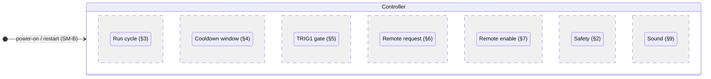
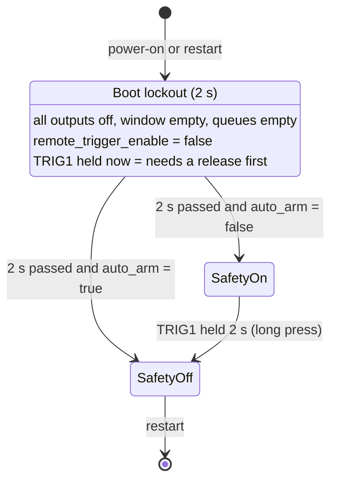
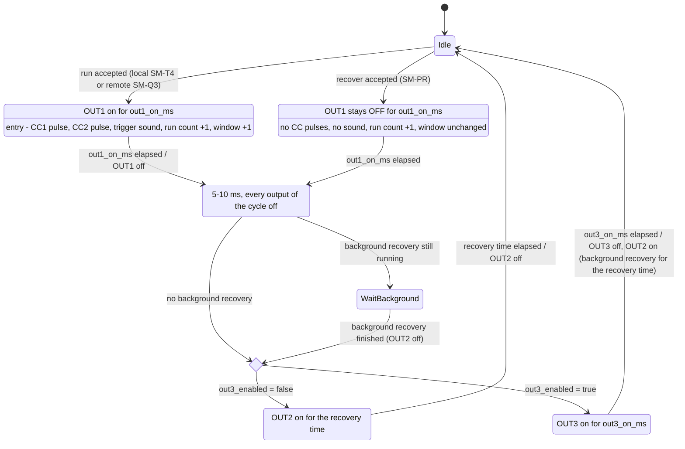
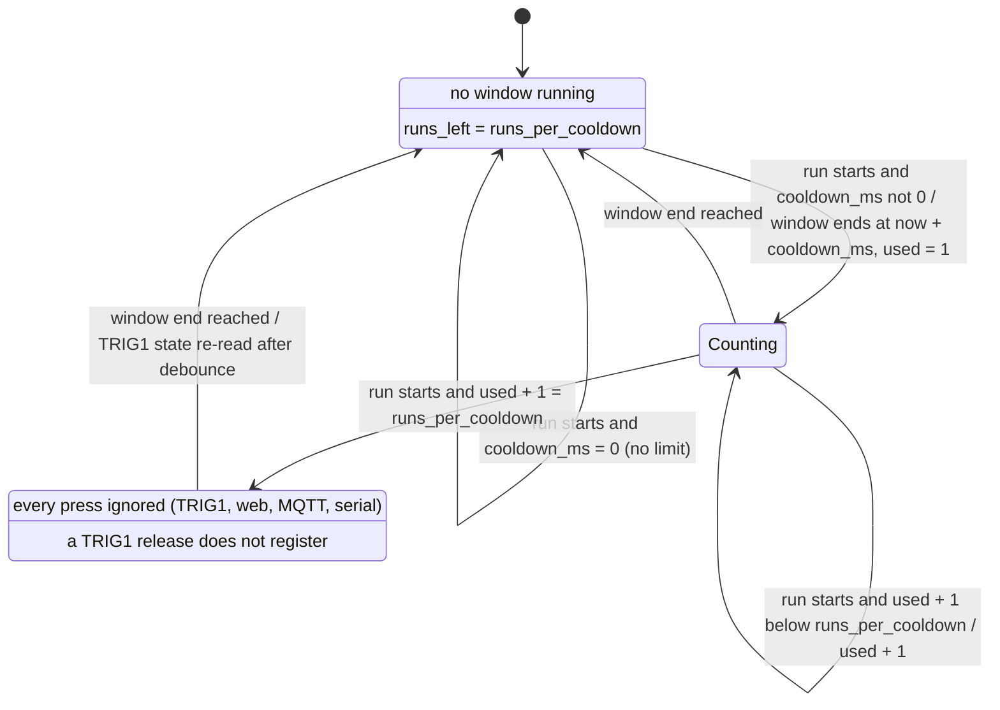
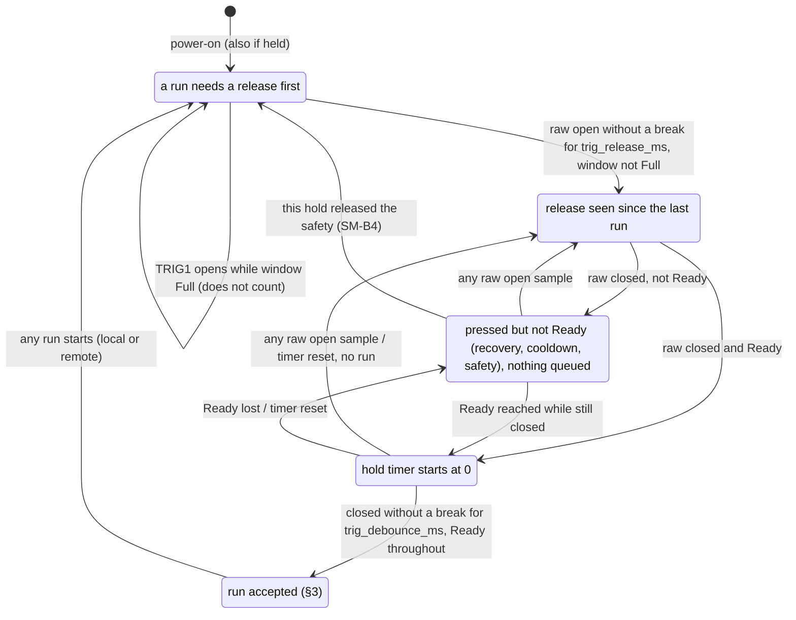
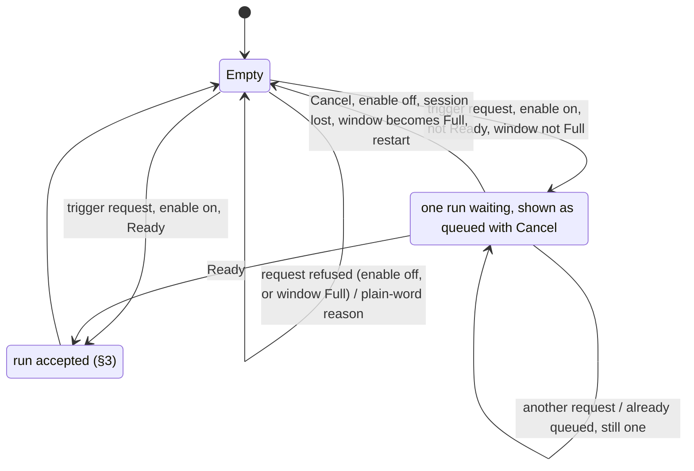
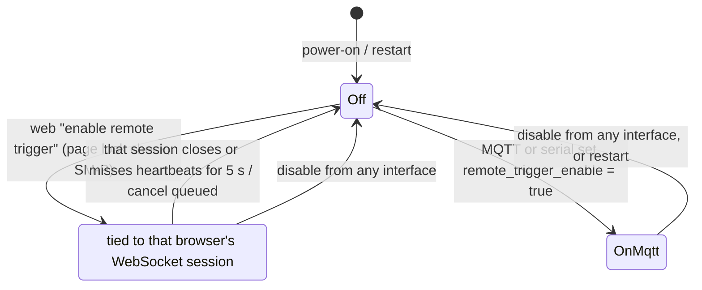
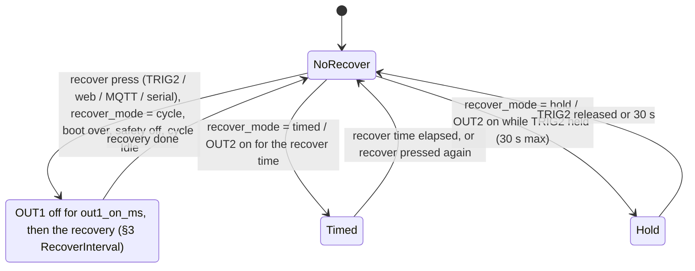
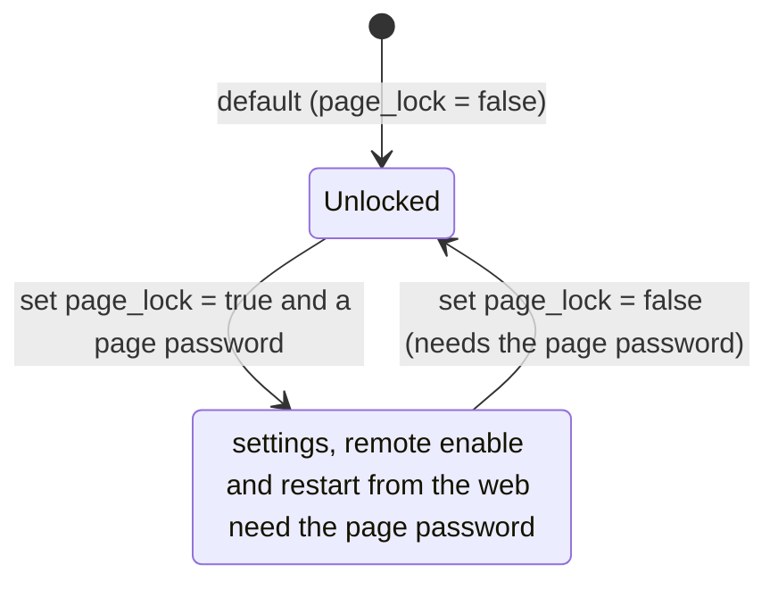
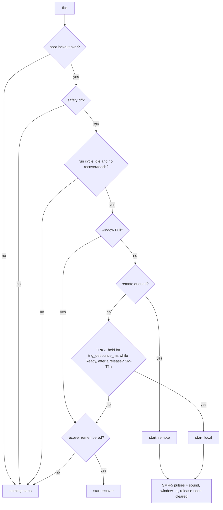

# Pulse-and-recover effect: state machine (reference)

The behaviour the firmware must implement for the pulse-and-recover effect: a trigger
starts a run, OUT1 pulses for a set time, OUT2 then runs the recovery, and a cooldown limits how many runs may
start in a window. Terminals use the board's names (TRIG1, OUT1 …); settings use generic, plain names that say what
they do. Code uses named constants for every limit and default, never a bare number. A project that wants its own
words (other key names, labels, MQTT topics) adds them as aliases in a profile (§11); the generic names never change.

This file is the reference the tests are checked against: each rule has an id (`SM-…`) and every id needs at least
one test that names it. Where a firmware differs, the firmware is wrong unless this file is changed first.

## How each firmware provides this effect

- Generic firmware: the effect is its own state machine beside the show engine (`effect = pulse_and_recover`). The
  defaults below are the effect's; the show engine's own `runs_per_cooldown` default stays 1, and no existing
  protocol key is renamed.
- Keys below that already exist in the generic firmware (`cooldown_ms`, `runs_per_cooldown`, `trig_debounce_ms`,
  `trig_release_ms`) are those keys. New keys use the same style.

## Terminals

| Terminal | Role in this effect |
|---|---|
| TRIG1 | the trigger; held 2 s releases the safety when `auto_arm` is off |
| TRIG2 | recover only (runs the recovery without the OUT1 pulse) |
| OUT1 | the pulse: on for `out1_on_ms` per run |
| OUT2 | the recovery: on for the recovery time after each run |
| OUT3 | optional after-pulse output (`out3_enabled`, default off): on for `out3_on_ms` before the recovery |
| OUT4 | optional ready lamp (default off) |
| CC1 (CONTACT1) | trigger out: `trigger_out_pulse_ms` pulse at every run |
| CC2 (CONTACT2) | sound out: `trigger_out_pulse_ms` pulse at every run |
| RLY1, RLY2 | unassigned by default; either may take any role above |
| SOUND (DFPlayer) | ambient loop while idle, the trigger sound at every run |

## Settings and defaults

| Setting | Default | Range | Takes effect |
|---|---|---|---|
| `out1_on_ms` (OUT1 pulse time) | 1000 | 10-60000 | next run |
| `out2_on_ms` (recovery time) | 5500 | 0-60000 | next recovery |
| `out3_enabled` | false | bool | next run |
| `out3_on_ms` | 1000 | 0-60000 | next run |
| `cooldown_ms` | 180000 (3 min); 0 = no cooldown | 0-3600000 | next window (a running window keeps its end) |
| `runs_per_cooldown` | 3 | 1-20 | next run (the running window's count stays) |
| `auto_arm` | true (safety off at power-on) | bool | next power-on |
| `recover_mode` | `cycle` | cycle / timed / hold | next recover |
| `trig_debounce_ms` (hold-to-confirm time, SM-T1a) | 100 | 10-1000 | immediately |
| `trig_release_ms` (release time a new run needs) | 100 | 10-1000 | immediately |
| `trigger_out_pulse_ms` (trigger out / sound out pulses) | 200 | 10-5000 | next run |
| `remote_trigger_enable` | false at every power-on | bool, never stored | immediately (see SM-R) |
| `page_lock` | false | bool | immediately (see SM-P) |

SM-S1: an out-of-range value is refused with a plain-word message and nothing changes. SM-S2: a stored value
survives a power cut and reads back identically over every interface (web, WebSocket, MQTT, serial), under its
generic key and under every alias of it (§11). SM-S3: the firmware neither measures nor checks load current and has
no load-current settings; each terminal's maximum rating is in `hardware/README.md`, and loads are chosen within it.

## 1. Overview: regions that run in parallel



**Ready** (shown as "armed") = safety off **and** boot lockout over **and** run cycle `Idle` **and** cooldown
window not `Full` **and** no recover or teach running (SM-A1). Every start attempt checks Ready at that moment.

## 2. Power-on, restart and safety (SM-B)



- SM-B1 After power-on or restart: every output off, the window empty, no queued request, `remote_trigger_enable`
  false, the remote enable session cleared, run count 0.
- SM-B2 Nothing runs or recovers during the 2 s boot lockout.
- SM-B3 A TRIG1 held at power-on never starts a run; it must be released first (SM-T).
- SM-B4 Safety on (only when `auto_arm` is false): nothing runs or recovers. A 2 s TRIG1 hold turns it off. That
  hold only releases the safety and never starts a run: the first run needs a release and a new press (Q1).
- SM-B5 Restart (web, MQTT `…/control/restart`, serial) is a full SM-B1 reset. There is no "stop" command.

## 3. Run cycle (SM-F)



- SM-F1 OUT1 is on for exactly `out1_on_ms` (one tick tolerance) per run, never longer, and never during a recover.
- SM-F2 The recovery time is `out2_on_ms`, read when OUT2 starts. There is no knob or analog input in this effect.
- SM-F3 With `out3_enabled` false (default), OUT1 and OUT2 are never on together, and the next run waits for the
  whole recovery.
- SM-F4 With `out3_enabled` true, the effect is Ready again when OUT3 goes off, while OUT2 recovers in the
  background; a run during the background recovery starts, and its own recovery waits at `WaitBackground`.
- SM-F5 Every run, whatever its source (TRIG1, web, MQTT, serial), pulses every output whose role is trigger out
  (CC1 by default) and every output whose role is sound out (CC2 by default) for `trigger_out_pulse_ms`, and starts
  the trigger sound. A recover does none of this.
- SM-F6 Status reports `pulsing` while OUT1 is on and `recovering` while OUT2 is on.

## 4. Cooldown window (SM-L)



- SM-L1 The window starts at the first run, not at the end of its recovery. Up to `runs_per_cooldown` runs may
  start inside it; each still waits for the recovery and the other Ready conditions.
- SM-L2 With the defaults (3 runs per 180 s): runs 1-3 start (each after its recovery); a 4th press inside the
  180 s is ignored; after the window ends the next press starts a run and a new window.
- SM-L3 `runs_per_cooldown` = 1 is a single cooldown: one run, then nothing until `cooldown_ms` has passed from that run.
- SM-L4 A recover never uses a window run and never starts or extends a cooldown: it blocks runs only while its own
  cycle runs (the OUT1 interval plus the recovery time). A recover may run while the window is `Full`; the cooldown
  limits runs only (Q2, Q3).
- SM-L5 While `Full`: presses are ignored, not queued; the web and MQTT answer "cooling down, m:ss left"; a queued
  remote request is cancelled (SM-Q5).
- SM-L6 Status reports `runs_left` and `cooldown_remaining_ms` (0 when `Open`); the web shows both.
- SM-L7 Changing `runs_per_cooldown` or `cooldown_ms` mid-window: the running window keeps its end time and its used
  count; the new count limit applies from the next run (if used ≥ the new limit, the window is `Full`).
- SM-L8 Restart clears the window (SM-B1).
- SM-L9 The board's run counters (PROTOCOL.md "Run counters": `runs_since_power_on`, `runs_lifetime`, the `run`
  event) count each Pulse entry, local or remote, as one run; a recover cycle (RecoverInterval) is not a run there.
  `run_count` keeps counting both (SM-PR3), so after a recover it is ahead of `runs_since_power_on`. A profile
  that wants the counters under its own names gives them status aliases.

## 5. TRIG1 gate (local trigger) (SM-T)



- SM-T1 TRIG1 is sampled raw at least every 1 ms (a firmware with a slower tick states its period, at most 5 ms).
  A release counts only after the raw input reads open without a break for `trig_release_ms`.
- SM-T1a **Hold to confirm (the misfire guard).** A local run needs TRIG1 to read closed on every sample, without a
  single open sample, for `trig_debounce_ms` (default 100 ms), **counted only while every other condition holds**:
  a release was seen since the last run and the effect is Ready (out of cooldown, or under the window's run limit;
  recovered; safety off). One open sample, or losing Ready, restarts the timer from 0. A tap, a dropped button,
  contact bounce or electrical noise shorter than `trig_debounce_ms` therefore never starts a run.
- SM-T2 Presses are not queued. Press, release, press, release during a recovery: no run.
- SM-T3 Pressed during the recovery and still held: exactly one run, `trig_debounce_ms` after Ready is reached.
- SM-T4 A local run starts only when SM-T1a is met: closed now and for the whole confirm time, a release seen since
  the last run, and Ready throughout.
- SM-T5 Held continuously since the last run: no further run until it is released and pressed again.
- SM-T6 Every run (local or remote) clears the release-seen flag, so a TRIG1 held while a remote run starts needs a
  release before it can start one. The 2 s hold that releases the safety clears it too (SM-B4).
- SM-T7 While the window is `Full`, a release does not register. At the window end the gate re-reads TRIG1: open
  for `trig_release_ms` → `Released`; held across the end → stays `NeedRelease` (no run until released and pressed
  again).

## 6. Remote request (web, MQTT, serial) (SM-Q)



- SM-Q1 One queued run at most (depth 1). A second request while one is queued changes nothing.
- SM-Q2 A web press queues one run; holding the web button does not repeat. The next run needs another press.
- SM-Q3 A queued request starts as soon as the effect is Ready (TRIG1's gate does not apply to it).
- SM-Q4 Every remote trigger needs `remote_trigger_enable`; without it the request is refused with the reason.
- SM-Q5 The queue is cancelled by Cancel, the enable going off, the enabling web session being lost (SM-R2), the
  window becoming `Full`, or restart; the web shows why.
- SM-Q6 MQTT `…/control/trigger` and the serial `trigger` command behave exactly like a web press.

## 7. Remote enable (SM-R)



- SM-R1 `remote_trigger_enable` is false at every power-on and never restored from storage.
- SM-R2 An enable given from a web page lasts only while that page's WebSocket session is alive. When it closes, or
  5 s pass without a heartbeat, the enable goes off and any queued remote run is cancelled, so an enable never
  outlives the phone that gave it.
- SM-R3 An enable set over MQTT or serial stays until it is disabled or the board restarts.
- SM-R4 Status reports the enable and who set it (`web:<session>`, `mqtt`, `serial`).

## 8. Recover only (SM-PR)



- SM-PR1 A recover never turns OUT1 on, never pulses CC1/CC2 and plays no sound.
- SM-PR2 A recover press while a cycle is running is remembered (one at most) and starts when the cycle is Idle;
  remote recover needs no remote enable.
- SM-PR3 A recover adds 1 to the run count but does not use a window run (SM-L4).

## 9. Sound (SM-SND)

- SM-SND1 When `ambient` is on and the card holds more than one track: the ambient track loops while no trigger
  sound is playing. With a single track on the card it is the trigger sound and there is no ambient.
- SM-SND2 Every run starts the trigger sound once (interrupting ambient); ambient resumes when it ends.

## 10. Page lock (SM-P)



- SM-P1 With `page_lock` off (default), joining the board's Wi-Fi is the only gate; no page password is asked.
- SM-P2 With `page_lock` on, the password is checked **before** any setting is saved, the remote enable is given, or
  a restart runs; a wrong password changes nothing.
- SM-P3 Turning `page_lock` off needs the page password.
- SM-P4 The page password is stored only as a salted hash; neither it nor the Wi-Fi password is ever printed,
  logged, published or sent back (both are set-only).

## 11. Aliases: a project's own names (SM-AL)

A profile can give the effect a project's own words without touching the generic names. It holds an alias table:

```json
{ "topic_prefix": "myprop",
  "aliases": [
    { "alias": "valve_time",     "key": "out1_on_ms",           "label": "Valve open time", "unit": "ms" },
    { "alias": "skip_after_output", "key": "out3_enabled",      "invert": true },
    { "alias": "go",             "control": "trigger" },
    { "alias": "presses",        "status": "run_count" },
    { "alias": "VALVE",          "terminal": "OUT1",           "label": "Valve" },
    { "alias": "REFILL",         "terminal": "TRIG2",          "label": "Refill button" } ] }
```

- SM-AL0 Terminals can be aliased too: `REFILL` and `TRIG2` then name the same input everywhere a terminal name is
  accepted (show cues and triggers, the beginner API, manual output tests, the web page and wiring view, status
  and events over WebSocket/MQTT/serial). The board name always keeps working; displays show the alias with the
  board name beside it (`REFILL (TRIG2)`) so the wiring stays traceable. Terminal aliases follow the same naming
  rules as key aliases (SM-AL4): unique, never another terminal's name.

- SM-AL1 An alias works everywhere its key does: web, WebSocket, MQTT (`<prefix>/<name>/config/set/<alias>`,
  `…/config/get/<alias>`, answer on `…/config/<alias>`), serial (`<alias>=value`, `<alias>`). Setting an alias sets
  its key; reading either gives the same value. Controls and status keys may be aliased the same way.
- SM-AL2 With aliases active, the board publishes status under the alias names (the generic names stay accepted for
  set/get); the web page shows the alias label and unit from the profile, and a control alias names its button with the
  board's word beside it (`go (Trigger)`).
- SM-AL3 `invert` (bool only) exposes the opposite meaning; `scale` (for example seconds ↔ ms) is the only other
  transform. Range checks use the key's range, reported in the alias's units.
- SM-AL4 The table is refused, with the reason, when an alias repeats another alias or any key, points at a key that
  does not exist, or aliases a set-only secret so it could be read back.
- SM-AL5 The table is part of the profile: stored on the board, kept through a power cut, read back by the desktop
  app's wizard. Loading or removing aliases never changes a value.
- SM-AL6 `topic_prefix` replaces `proptroller` in every MQTT topic, the broadcast topics included.
- SM-AL7 A project's profile lives with that project, not in this repository; the public repository carries only
  generic names and an example table like the one above.

## 12. Network addressing (SM-N)

- SM-N1 The only broadcast topics are `<prefix>/broadcast/getName` (request) and `<prefix>/broadcast/name` (each board
  answers with its name). Everything else is addressed to one board: `<prefix>/<name>/config/set/<key>`,
  `…/config/get/<key>` (answer on `…/config/<key>`), `…/status/<key>`, `…/status/get/<key>`,
  `…/control/trigger|recover|restart`. `<prefix>` is `proptroller` unless a profile sets `topic_prefix`.
- SM-N2 A setting or control sent to a broadcast or wildcard topic is ignored.
- SM-N3 With several boards on one broker, setting one board changes no other board.
- SM-N4 Status topics are retained; a last-will marks the board offline.

## 13. The start decision, every tick



Order of precedence in one tick: remote queued, then local, then recover (only one thing starts per tick).

## 14. Invariants (the randomized test checks every one, every tick)

- I1 No more than `runs_per_cooldown` runs start inside any window of `cooldown_ms` that begins at a first run.
- I2 No run or recover while the safety is on or in the boot lockout.
- I3 No remote run without `remote_trigger_enable` at the moment it starts.
- I4 OUT1 on ≤ `out1_on_ms` (+ one tick) per run; OUT1 never on during a recover.
- I5 With `out3_enabled` false, OUT1 and OUT2 are never on together.
- I6 At most one queued remote run and one remembered recover.
- I7 A local run is always preceded by a TRIG1 release (≥ `trig_release_ms`, registered outside a `Full` window)
  after the previous run.
- I8 Every run pulses the trigger-out and sound-out roles exactly once; no recover pulses them.
- I9 After a restart: all outputs off, window empty, queues empty, enable off.
- I10 Every local run is preceded by at least `trig_debounce_ms` of TRIG1 closed on every sample, all of it while
  Ready and after a release; no closure shorter than that, in any pattern, ever starts a run.

## 15. Required scenarios

Each is an end-to-end test against the simulator (web/WebSocket, MQTT broker, serial) and, where it fits, a unit
test. Times assume the defaults.

| Id | Scenario | Expected |
|---|---|---|
| E1 | press-release-press-release on TRIG1 during a recovery | no run |
| E2 | press TRIG1 during a recovery and hold | exactly one run, `trig_debounce_ms` after the recovery ends |
| E3 | hold TRIG1 through a run and its recovery | one run only |
| E4 | 3 runs inside 180 s, then a 4th press | 4th ignored, "cooling down" with time left |
| E5 | hold TRIG1 across the window end | no run; release + press after the end starts one |
| E6 | press and release TRIG1 several times during a `Full` window, hold it closed at the end | no run at the end; release + press after the end starts one |
| E7 | web press during a recovery | one queued run, starts when Ready; a second press is "already queued" |
| E8 | web press then Cancel | no run |
| E9 | web enable, then close the page / drop Wi-Fi | enable off within 5 s, queued run cancelled |
| E10 | MQTT trigger without the enable | refused |
| E11 | every source starts one run (TRIG1, web, MQTT, serial) | CC1 and CC2 pulse `trigger_out_pulse_ms` and the trigger sound plays each time |
| E12 | recover (TRIG2, web, MQTT) | OUT1 stays off, no pulses, no sound, window unchanged |
| E13 | restart mid-window with a queued run | all cleared (SM-B1) |
| E14 | change `runs_per_cooldown` 3 → 1 after one run | the window is `Full` |
| E15 | two boards on one broker, set a key on one | the other unchanged; a broadcast set ignored by both |
| E16 | `page_lock` on: wrong password on Save | nothing saved; turning the lock off without the password refused |
| E17 | `cooldown_ms` = 0 | no window; runs limited only by recoveries |
| E18 | `out3_enabled` true, run during the background recovery | starts; its recovery waits for the background one |
| E19 | TRIG1 held at power-on | no run until released and pressed |
| E20 | `auto_arm` false: 2 s hold, keep holding | safety off, no run; release + press starts one |
| E21 | Ready, released: TRIG1 closures of 1, 10, 50 and 99 ms, singly and as a fast train (taps, a drop, noise) | no run |
| E22 | Ready, released: TRIG1 closed and held | one run exactly `trig_debounce_ms` after the closure |
| E23 | Ready: hold 60 ms, one 1 ms open sample, hold again | one run `trig_debounce_ms` after the open sample, not before |
| E24 | hold during the recovery; Ready is reached; Ready lost for one tick | timer restarts; one run `trig_debounce_ms` after Ready returns |
| E25 | recover during a `Full` window | the recover runs; runs stay locked until the window ends |
| E26 | recover, then press TRIG1 right after its recovery time | a run starts (a recover adds no cooldown) |
| E27 | example alias table loaded: set and get each alias over web, MQTT and serial | same values as the generic keys; status published under the alias names; labels shown |
| E28 | inverted bool alias set true | its key reads false |
| E29 | alias table with a repeated name, an unknown key, or a secret | refused with the reason; nothing changes |
| E30 | `topic_prefix` set | every topic, broadcast included, uses the new prefix; the old prefix is ignored |
| E31 | terminal alias `REFILL` → TRIG2: a show triggered by `REFILL`, a manual test of `VALVE`, the wiring view | works exactly as `TRIG2` / `OUT1`; displays read `REFILL (TRIG2)`; an alias equal to another terminal (`OUT2`) is refused |

## Clarifications

| Id | Question | Answer |
|---|---|---|
| Q1 | After the 2 s hold that takes the safety off, does that same hold start a run once Ready? | no: it only releases the safety (SM-B4) |
| Q2 | Does a recover start a cooldown? | no: a recover blocks runs only for its own cycle (SM-L4) |
| Q3 | May a recover run while runs are locked by the cooldown (window `Full`)? | yes: the cooldown limits runs only (SM-L4) |
| Q4 | Hold-to-confirm time (SM-T1a)? | 100 ms |
